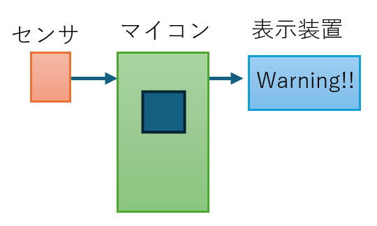
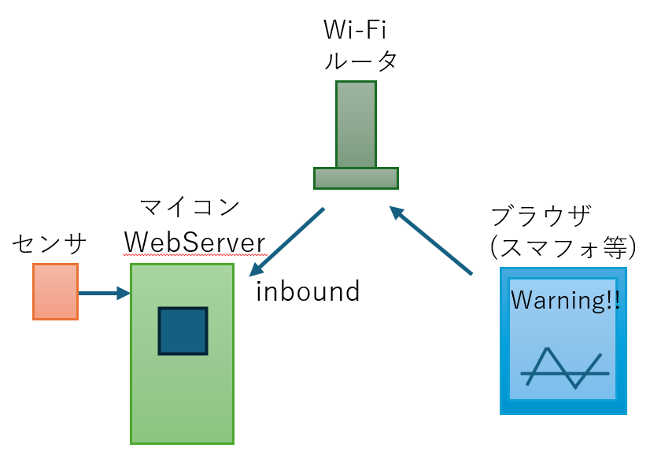
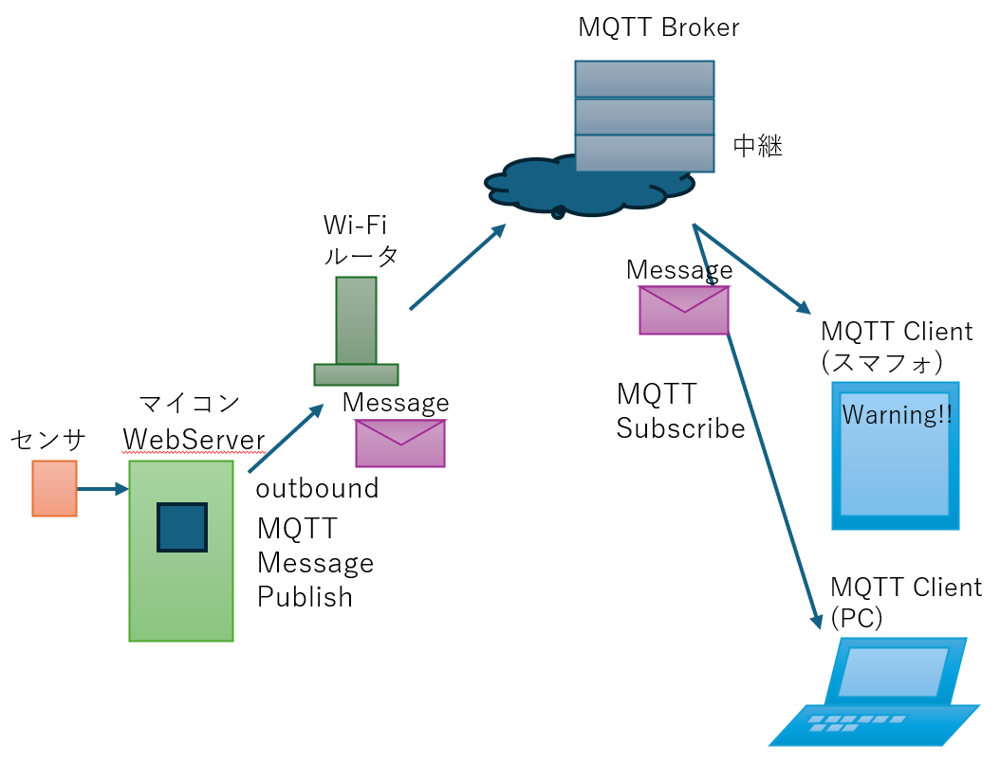
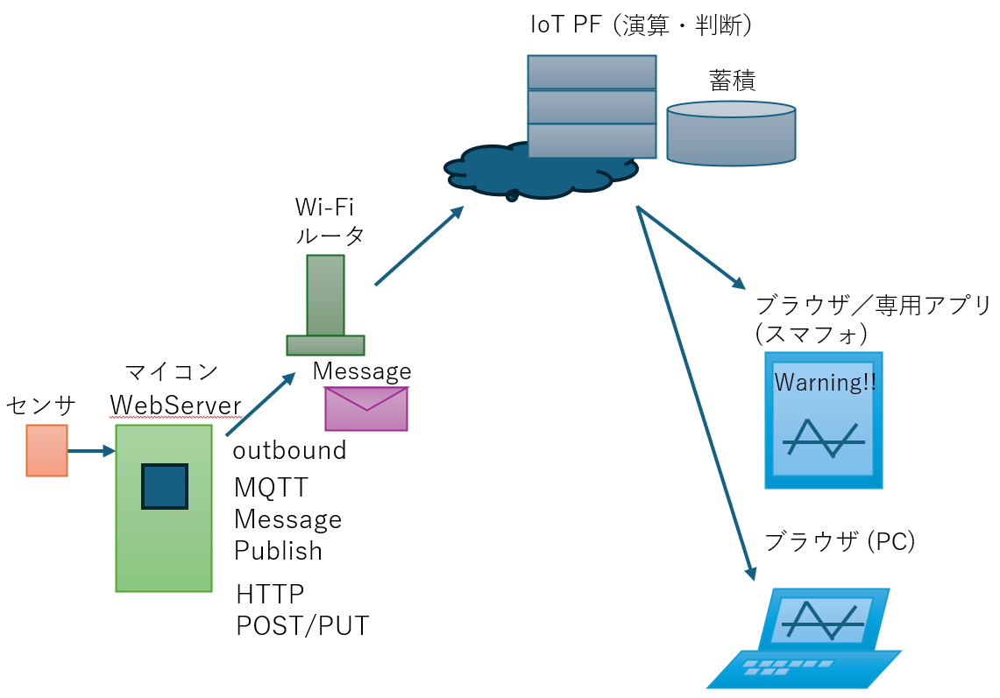

# システム試作のアプローチ

マイコンを活用したアプリを試作する上で、扱うデータと処理の例、実現アーキテクチャのデザインパターンを簡単にまとめます。網羅的ではありませんが、考え方のヒントになるように特徴的な事例を抽出して整理しています。

## 取り扱うデータと処理の方法
コンピュータの処理は、（１）入力、（２）蓄積・演算・判断、（３）出力、に分かれます。マイコンを活用したアプリでの、入力、演算、出力を考えます
- 入力
  - センサによる測定、取得
    - 温度、湿度、気圧、CO2、NOx、土壌の湿度、etc
    - 人感センサ、歪センサ、圧力計、加速度計、ジャイロセンサ、距離センサ
    - カメラによる画像入力
    - マイクによる音声入力 
  - 人間による入力
    - ボタン操作、ボリューム（スライダ）操作、ロータリスイッチ操作
  - インターネットからデータ取得(TCP/IPプロトコル（HTTP/MQTT/WebAPI)による) 
    - 時刻同期 
    - 天気予想
    - 潮位、河川の水位、黄砂・PM2.5測定、等
    - 金融情報（為替、株価、etc）
    - 宿や交通の予約状況、チケットや各種商品の価格変化 etc     
- 蓄積、演算、判断
  - 蓄積（過去データの蓄積）
    - 短期間の蓄積(サンプル数:数百、期間は当日分) 
    - 長期間の蓄積(サンプル数:数千以上、期間は数カ月～数年) 
  - 演算
    - 移動平均等によるノイズ除去
    - 傾向（トレンド）分析(上昇傾向、下降傾向) 
    - 画像処理
      - 色判断、形状判断(食物の生育等) 
      - 姿勢推定、人物特定、ハンドサイン特定
      - 音声パターンマッチング
  - 判断
    - 正常異常判断（正常値、異常値、禁止状態の発生） 
    - 姿勢判断、位置判断
    - Wake Word(呼びかけ)
    - 生育判断
    - 人物の認証 (通過許可等) 
- 出力
  - 各種表示装置
    - LED、液晶ディスプレイ、デジタルTV、プリンタ
    - 警告灯
  - モータ類
    - モータ（ステッピングモータ、サーボモータ、アクチュエータ）
  - 音声出力
    - 警告音、音楽、音声出力
  - その他
    - 家電制御(IrDA(赤外線リモコン)、EchonetLiteWebAPI)
    - 各種API連携
      - メール送信、SNS等へのPUSH通知、etc  

## マイコンを使った実現方法、デザインパターン

|パターン名|構成図|特徴|
|--|--|--|
|パターン1：マイコンとセンサ表示装置のみ| (図の矢印はデータ(情報)が流れる方向を示しています)|・ネットワーク接続なし、Stand Alone動作 ・出力結果を得るためマイコン装置まで行く|
|パターン2：WebServer機能を持つマイコン| 注：この図の矢印はネットワークの接続方向を示しています|・WebServerによりブラウザから閲覧可能 ・同一LAN内から複数メンバが出力結果参照可 ・努力次第でグラフ化可能(手作り)|
|パターン3：MQTTを介した情報発信| (図の矢印はデータ(情報)が流れる方向を示しています)|・MQTT Brokerを介することで、遠隔地のメンバが参照可能 ・MQTT Clientによるデータ表示 ・JSによるデータビューア(手作り)・マイコン側がMQTT Subscribeすることで遠隔からのメッセージを受信し、遠隔からマイコン配下のデバイスを制御可能|
|パターン4：IoT PFによるデータ蓄積、演算、判断| (図の矢印はデータ(情報)が流れる方向を示しています)|・IoT PFを契約してデータ蓄積、一覧化、演算、判断が可能 ・IoT PFによりアカウント管理可能|

### パターン１：マイコンとセンサ、表示装置だけで実現
- ネットワーク接続なしでStand Aloneで動作させる
- セキュリティの観点で安全
- データの送信や遠隔からの制御は不可
- 機械学習や画像処理等の高度な判断は難しい
### パターン２：ネットワーク接続できるマイコンとセンサ、ブラウザで実現
- マイコンにWebServer機能を持たせる
- マイコンへの接続(inbound)はローカルネットワークに限定
- マイコンから外部サーバに接続してデータを取得することも可能(outbound)
- ブラウザによる表示、ブラウザからの操作が可能
- 同一ネットワーク内であれば装置から離れた場所でも情報取得、制御可能
### パターン３：マイコンとセンサ、MQTT ブローカ、ブラウザ(MQTT Client)で実現
- マイコンにMQTT Clientの機能を持たせてMQTT BrokerにPublishする
- データは世界中から参照可能(MQTT BrokerにSubscribeする)
- データの表示はMQTT Clientのみでも可能
- マイコンが特定のTopicsをSubcribeすることで遠隔地からのデータ取得が可能
- 遠隔地の情報を表示したり、遠隔からの制御が可能
- 脆弱性を作りこまないよう、セキュリティ設計が必要
### パターン４：マイコンとセンサ、IoT PF、ブラウザ（または専用アプリ）で実現
- IoT PFを契約して測定データをIoT PFに送信する
- データの蓄積、演算、判断はIoT PF側で行う
   - １年以上の長期間にわたる大量のデータ蓄積が可能
   - 長期間の傾向を分析、今後の傾向が予測可能、去年の傾向と比較可能（植物の生育傾向等） 
   - 機械学習や画像処理等の高度な判断が可能（立ち入り監視、異常人物監視等）
- 有償のIoT PFを活用することで、サービス利用者の認証、認可が可能になる
- データやマイコン側のセキュリティもIoT PFの設計方針に従うことである程度守ることができる

## デザインパターンの選び方
- マイコン内の簡単な演算で処理が完結する場合や、データを参照する人が遠隔地でない場合はパターン1のStand Aloneによる実装が望ましい（理由：プログラムがシンプル、セキュリティリスクが低い）
- 長期間のデータを保存し、グラフ化する場合、IoT PFの利用が必要（パターン４）
- IoT PFを利用しない場合
   - マイコン側でSDカードを接続して長期データ蓄積も可能(パターン１) （注意：ストレージ故障、盗難、紛失のリスク） 
   - 同一LAN内の制限のもとで、ブラウザでグラフ表示する、ブラウザに描画されるスッチで機器操作を試すならパターン２
   - インターネット越しに、MQTT Clientによるデータ表示させたい、あるいは、クライアント側でビューアを作ってグラフ化するならパターン３
- なお、上記デザインパターンに含まれていませんが、WebAPIを呼び出してマイコン上のアプリと連携する場合、パターン３をベースに、MQTT ブローカへの接続ではなく、WebServerへの接続が必要になります。
