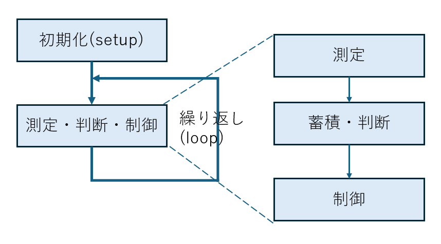

# 取り扱うデータとプログラムの基本構造

マイコンシステムに限らず、コンピュータシステムは、１．入力、２．蓄積・演算、３．出力の流れで動くと思います。この流れをマイコンに当てはめてみて、どのような入力、出力、演算が〇〇か整理します。

## 取り扱うデータと処理の方法

入力、処理、出力の各段階の主なデータ例を示します。通信機能を持ったシステムでは、ネットワークを介して外部サービスとの連携も可能になります。
- 入力
  - センサによる測定、取得
    - 温度、湿度、気圧、CO2、NOx、土壌の湿度、等
    - 人感センサ、歪センサ、圧力計、加速度計、ジャイロセンサ、距離センサ
    - カメラによる画像入力
    - マイクによる音声入力 
  - 人間による入力
    - ボタン操作、ボリューム（スライダ）操作、ロータリスイッチ操作
  - インターネット経由でHTTP、MQTT、Web API 等を用いてデータを取得 
    - 時刻同期 
    - 天気予報
    - 潮位、河川の水位、黄砂・PM2.5測定、等
    - 金融情報（為替、株価、等）
    - 宿や交通の予約状況、チケットや各種商品の価格変化 等
- 蓄積、演算、判断
  - 蓄積（過去データの蓄積）
    - 短期間の蓄積(サンプル数:数百、期間は当日分) 
    - 長期間の蓄積(サンプル数:数千以上、期間は数カ月～数年) 
  - 演算
    - 移動平均等によるノイズ除去
    - 傾向（トレンド）分析(上昇傾向、下降傾向) 
    - 画像処理
      - 色判断、形状判断(食物の生育等) 
      - 姿勢推定、人物特定、ハンドサイン特定
      - 音声パターンマッチング
  - 判断
    - 正常異常判断（正常値、異常値、禁止状態の発生） 
    - 姿勢判断、位置判断
    - Wake Word(呼びかけ)
    - 生育判断
    - 人物の認証 (通過許可等) 
- 出力
  - 各種表示装置
    - LED、液晶ディスプレイ、デジタルTV、プリンタ
    - 警告灯
  - モータ類
    - モータ（ステッピングモータ、サーボモータ、アクチュエータ）
  - 音声出力
    - 警告音、音楽、音声出力
  - その他
    - 家電制御(IrDA(赤外線リモコン)、EchonetLiteWebAPI)
    - 各種API連携
      - メール送信、SNS等へのPUSH通知、等

## プログラムの基本構造
マイコンのプログラムの基本構造を考えます。センサで値を取得、蓄積、判断し、表示装置やモータ、警告灯を使ってフィードバックします。IoTシステムの場合、ネットワークでサーバと接続し、測定データを送信したり、サーバから情報を得て表示装置や各種モータを動かすことも可能です。
センサを活用した組み込みプログラミングの場合、ソースは以下の構造になります。

setup/loopと書いていますが、概念上の表現です。関数名としてsetup(),loop()にしないといけないと言った制約はありません。

### 初期化処理(setup)
- 使用するセンサや出力装置の初期化を行います
  - 接続手段に応じて、周辺IOを初期化
  - センサや出力装置のドライバを初期化
  - データを蓄積する配列等の作成

### 繰り返し処理(loop)
- 測定、蓄積判断、出力を繰り返します
  - 入力（測定）：センサを使って環境や監視対象の情報を取得します。ネットワークを介して情報を取得する場合もあります。
  - 蓄積・判断：得られた値に対して判断を行います。過去に取得した値をベースに正常、異常の判断を行う場合があります。センサから得られる値はそのまま使える場合もありますが、異常値判断、フィルタによる平滑化等の各種処理が必要になる場合があります。
  - 出力：モータやディスプレイ、警告灯等を使って出力します。HTTPやMQTTを使って測定値をIoT PFにアップロードする場合もあります
 
#### ソースコードの例
[演習：対象物までの距離を計測してLCDに表示する](https://github.com/foobarbazfred/Pico-MicroPython-Workshop/blob/main/3-Day1-Foundation/3-7-distance-sensor.md#%E6%BC%94%E7%BF%92%E5%AF%BE%E8%B1%A1%E7%89%A9%E3%81%BE%E3%81%A7%E3%81%AE%E8%B7%9D%E9%9B%A2%E3%82%92%E8%A8%88%E6%B8%AC%E3%81%97%E3%81%A6lcd%E3%81%AB%E8%A1%A8%E7%A4%BA%E3%81%99%E3%82%8B)
