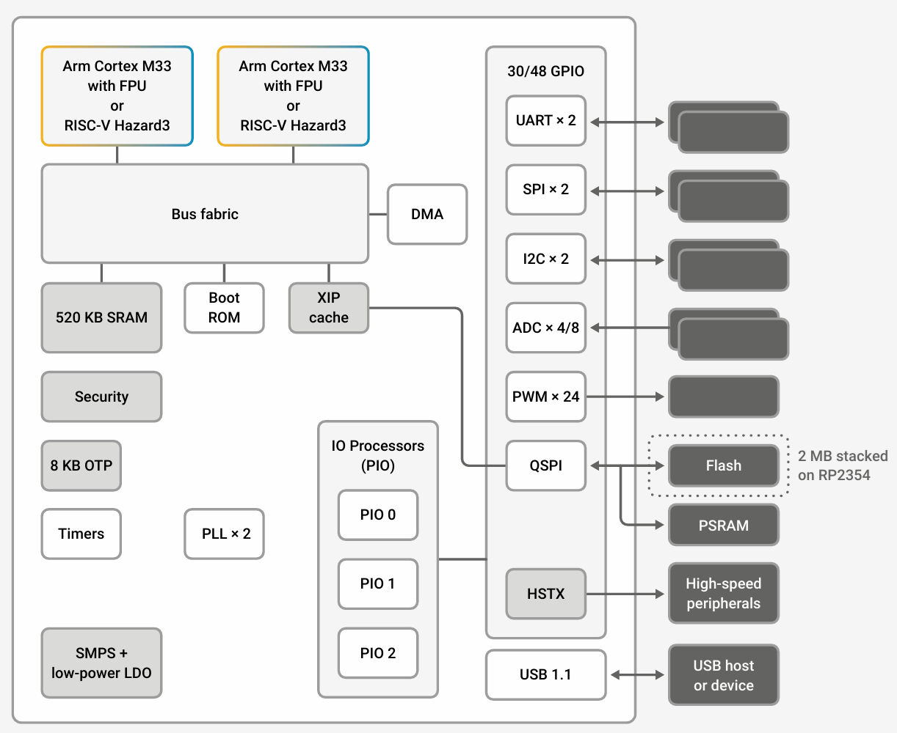
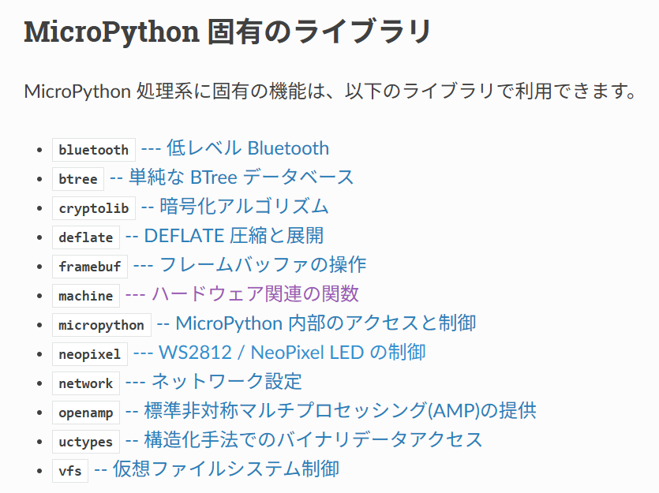
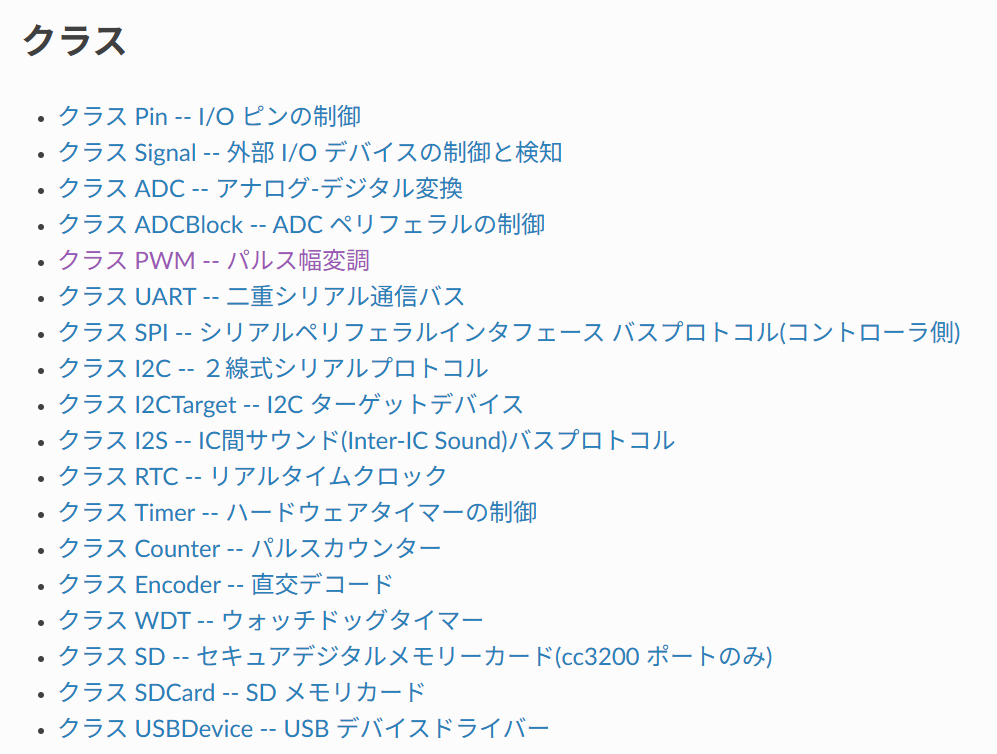
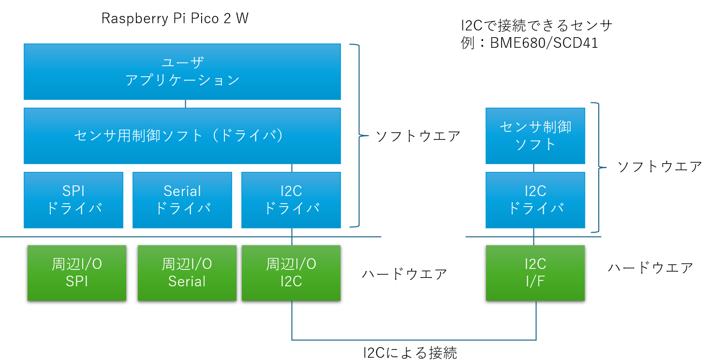

### MicroPython概要 (Pythonとの違い)
- MicroPython特有の注意点を説明　(https://micropython-docs-ja.readthedocs.io/ja/latest/rp2/quickref.html)
  - マイコン専用のモジュール、Pinの取り扱い等 
- MicroPythonはマイコンを使いこなすためにモジュールが追加されています。周辺I/Oを制御する場合、モジュールを使うことで可能になります
- 特に重要なのはmachineモジュールです。machineモジュール配下に、UART/I2C/SPI用Classが提供されています
- I2CやSPIで接続される周辺機器を制御する場合、machineモジュール配下のクラスを使ってマイコンの周辺I/Oを制御します
- 用語の整理
  - モジュール： ある目的のために実現された機能の集まり、xx.pyのファイルで提供される。または、MicroPythonファームに最初から組み込まれている。モジュールは、import machine 等、読み込み文を経て利用可能になる
  - クラス：モジュール内で定義されているオブジェクトの型
  - ライブラリ：人間が把握しやすいために、モジュールやクラス等をまとめて表現する呼び名、概念（Pythonの言語仕様上はライブラリの概念はなし）

<br>

<br>
machineモジュール内のクラス一覧<br>
<br>
https://micropython-docs-ja.readthedocs.io/ja/latest/library/index.html#micropython-lib-micropython<br>
https://micropython-docs-ja.readthedocs.io/ja/latest/library/machine.html#classes<br>


- ユーザのプログラムがセンサ等を制御する場合のソフトウェア、ハードウェアの構成を以下に示します。I2C/SPIはデバイスと接続する役割を提供しますが、センサをどのように制御するか？は制御用ソフトウェアが必要です。これらはドライバと呼ばれます。ドライバは自作することもできますが、有名な周辺機器（LCD ディスプレイ、各種センサ類）であれば、GitHub等で公開されており、そのまま使うこともできます。<br>
 

ソースコードの例：<br>
[CO2センサ活用](3-x-CO2-sensor.md)

#### MicroPython/CircuitPython比較

- MicroPythonかCircuitPythonか？
  - CircuitPythonはMicroPythonから派生した言語で、Adafruit社が開発メンテナンス<br>[Welcome to CircuitPython!](https://learn.adafruit.com/welcome-to-circuitpython)
  - 基本的なPythonの仕様は同じだが提供されるモジュールが異なる。同等のモジュールでもメソッド（関数）の仕様が異なる
  - CircuitPythonはAdafruit社が販売するセンサをサポートする形で、センサ用の制御モジュール（通称：ドライバ）が提供される場合が多い
  - Adafruit社がセンサや表示デバイス用のドライバを体系的に管理<br>[Adafruit CircuitPython Library Bundle](https://docs.circuitpython.org/projects/bundle/en/latest/drivers.html)<br>[環境センサ用ドライバ類](https://docs.circuitpython.org/projects/bundle/en/latest/drivers.html#environmental-sensors)
  - USBキーボード等、USBデバイスを試作するには、USBデバイス用のライブラリが充実しているCircuitPythonで実装するがお勧め
  - MicroPythonを基本に使い、使いたいセンサのドライバがCircuitPython版しかない場合、CircuitPythonを選択するのが良いのでは。
     - CircuitPython版ドライバをMicroPython版にポーティングすることも可能
    
MicroPythonの組み込みモジュール一覧
```
MicroPython v1.29.0 on 2026-08-24; Raspberry Pi Pico 2 W with RP2350
Type "help()" for more information.
>>> help('modules')
__main__          asyncio/__init__  hashlib           rp2
_asyncio          asyncio/core      heapq             select
_boot             asyncio/event     io                socket
_boot_fat         asyncio/funcs     json              ssl
_onewire          asyncio/lock      lwip              struct
_rp2              asyncio/stream    machine           sys
_thread           binascii          math              time
_webrepl          bluetooth         micropython       tls
aioble/__init__   builtins          mip/__init__      uasyncio
aioble/central    cmath             neopixel          uctypes
aioble/client     collections       network           urequests
aioble/core       cryptolib         ntptime           vfs
aioble/device     deflate           onewire           webrepl
aioble/l2cap      dht               os                webrepl_setup
aioble/peripheral ds18x20           platform          websocket
aioble/security   errno             random
aioble/server     framebuf          re
array             gc                requests/__init__
Plus any modules on the filesystem
```

CircuitPythonの組み込みモジュール一覧
```
Adafruit CircuitPython 10.3.2 on 2026-11-11; Raspberry Pi Pico with rp2040
>>> help('modules')
__future__        bitmaptools       lvfontio          terminalio
__main__          bitops            math              tilepalettemapper
_asyncio          board             memorymap         time
_bleio            builtins          microcontroller   touchio
_eve              busdisplay        micropython       traceback
_pixelmap         busio             msgpack           ulab
adafruit_bus_device                 codeop            neopixel_write    ulab.numpy
adafruit_bus_device.i2c_device      collections       nvm               ulab.numpy.fft
adafruit_bus_device.spi_device      countio           onewireio         ulab.numpy.linalg
adafruit_pixelbuf digitalio         os                ulab.scipy
aesio             displayio         paralleldisplaybus                  ulab.scipy.linalg
alarm             epaperdisplay     picodvi           ulab.scipy.optimize
analogbufio       errno             pulseio           ulab.scipy.signal
analogio          floppyio          pwmio             ulab.scipy.special
array             fontio            qrio              ulab.utils
atexit            fourwire          rainbowio         usb
audiobusio        framebufferio     random            usb.core
audiocore         gc                re                usb.util
audiodelays       getpass           rgbmatrix         usb_audio
audiofilewriter   gifio             rotaryio          usb_cdc
audiofilters      hashlib           rp2pio            usb_hid
audiofreeverb     i2cdisplaybus     rtc               usb_host
audioi2sin        i2ctarget         sdcardio          usb_midi
audiomixer        imagecapture      select            usb_video
audiomp3          io                sharpdisplay      vectorio
audiopwmio        jpegio            storage           warnings
audiospeed        json              struct            watchdog
binascii          keypad            supervisor        wiznet
bitbangio         keypad_demux      synthio           zlib
bitmapfilter      locale            sys
Plus any modules on the filesystem
>>> 
```
