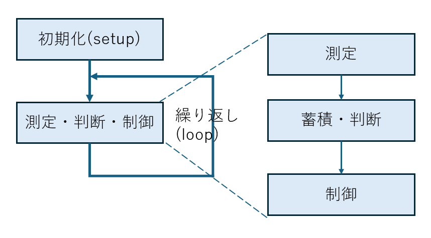

# 取り扱うデータとプログラムの基本構造

## プログラムの基本構造
マイコンを使ったIoT用プログラムは、基本的に用途として、エッジ端末としての使い方が主になると思われます。センサで値を取得、蓄積、判断し、表示装置やモータ、警告灯を使ってフィードバックします。また、場合によってはIoT プラットフォームに測定データを送信します。
センサを活用した組み込みプログラミングの場合、ソースは以下の構造になります。

setup/loopと書いていますが、概念上の表現です。関数名としてsetup(),loop()にしないといけないと言った制約はありません。

### 初期化処理(setup)
- 使用するセンサや出力装置の初期化を行います
  - 接続手段に応じて、周辺IOを初期化
  - センサや出力装置のドライバを初期化
  - データを蓄積する配列等の作成

### 繰り返し処理(loop)
- 測定、蓄積判断、出力を繰り返します
  - 測定：センサを使って環境や監視対象の情報を取得
  - 判断：得られた値に対して判断を行います。過去に取得した値をベースに正常、異常の判断を行う場合があります。センサから得られる値はそのまま使える場合もありますが、異常値判断、フィルタによる平滑化等の各種処理が必要になる場合があります。
  - 出力：モータやディスプレイ、警告灯等を使って出力します。HTTPやMQTTを使って測定値をIoT PFにアップロードする場合もあります
 
#### ソースコードの例
[演習：対象物までの距離を計測してLCDに表示する](https://github.com/foobarbazfred/Pico-MicroPython-Workshop/blob/main/3-Day1-Foundation/3-7-distance-sensor.md#%E6%BC%94%E7%BF%92%E5%AF%BE%E8%B1%A1%E7%89%A9%E3%81%BE%E3%81%A7%E3%81%AE%E8%B7%9D%E9%9B%A2%E3%82%92%E8%A8%88%E6%B8%AC%E3%81%97%E3%81%A6lcd%E3%81%AB%E8%A1%A8%E7%A4%BA%E3%81%99%E3%82%8B)
