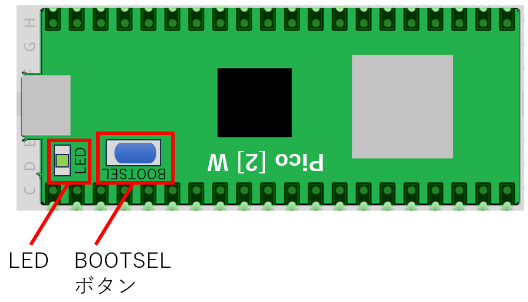
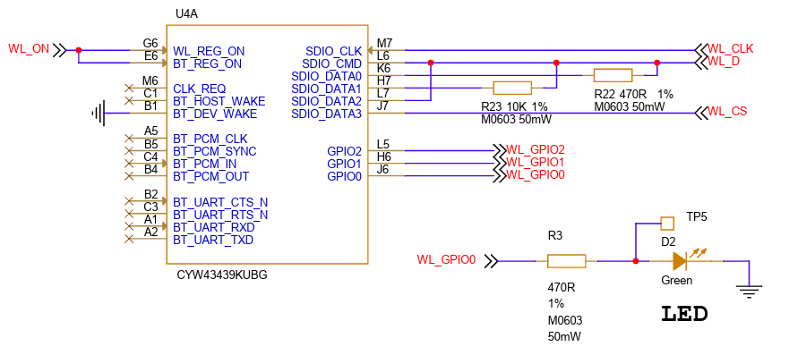
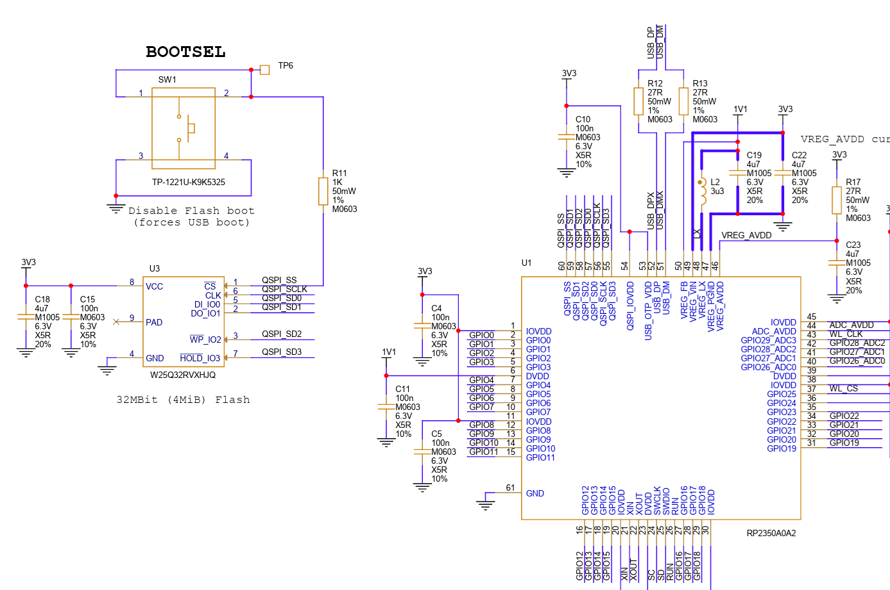

# 1-1  参考：最もシンプルなLED点滅
RaspberryPi Pico 2 W上にはLEDが実装されておりプログラムで点滅させることができます。



ボード上のLEDを点滅させるプログラムは以下。
```
from machine import Pin
import time

# setup for LED Pin
led = Pin('LED', Pin.OUT)

# loop; LED blink
while True:
    led.on()
    time.sleep(1)
    led.off()
    time.sleep(1)
```
また、ボード上にはBOOTSELボタンがあります。このボタンは起動時のモードを指定するために使いますが、起動後は押しボタンスイッチとして使うことができます。
BOOLSELボタンに連動してLEDが点灯するプログラムは以下
```
from machine import Pin
from rp2 import bootsel_button

# setup for LED Pin
led = Pin('LED', Pin.OUT)

# loop; LED on if button is pressed
while True:
    if bootsel_button() == 1:
        led.on()
    else:
        led.off()
```
上記いずれも配線が不要ですぐに使えるLEDとスイッチです。
ご参考にボードの回路図を付けます（MicroPythonから単純にGPIOモジュール等ではアクセスできない位置に配置されています）

LEDの配線図（Wi-Fiコントローラ配下に接続）



BOOTSELの配線図(マイコン(RP2350)のQSPI_SS用のピンに接続)




