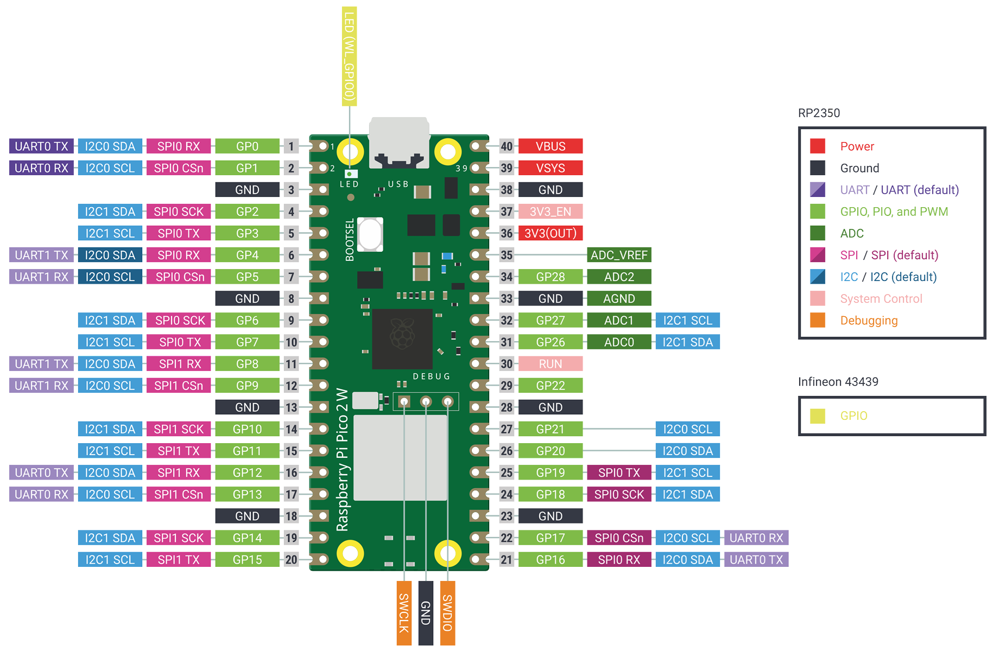
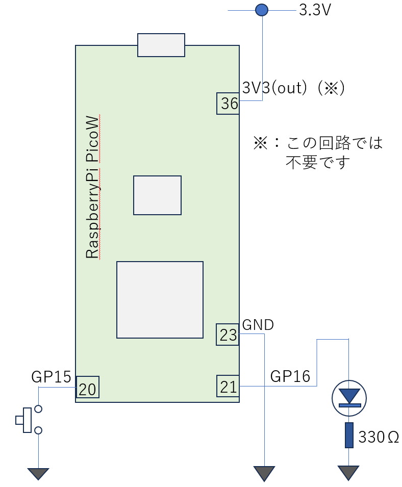
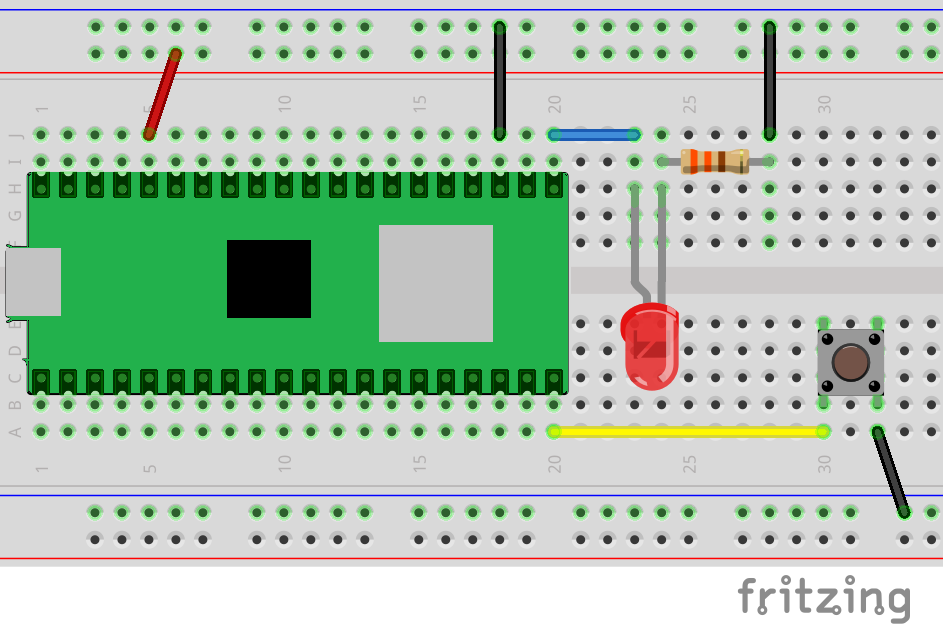
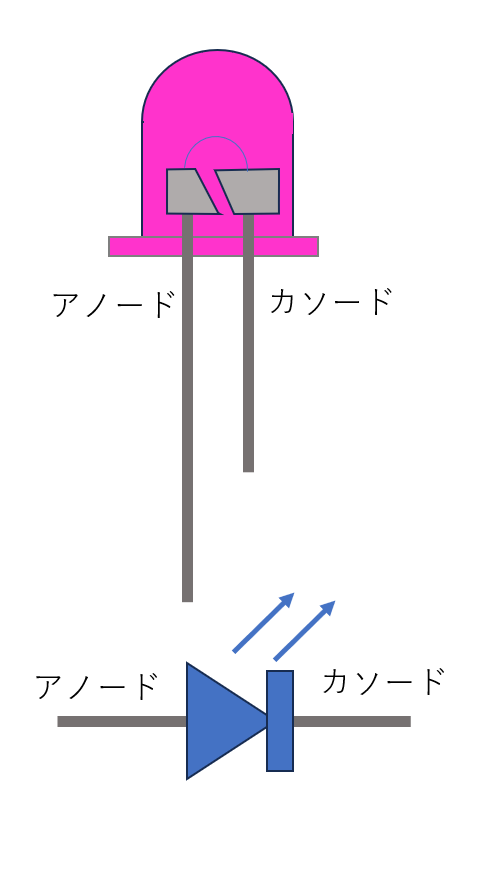
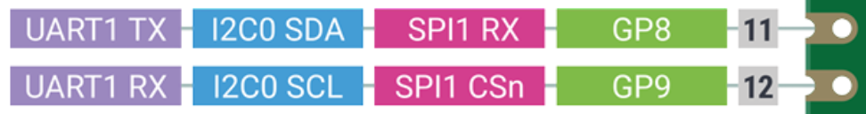
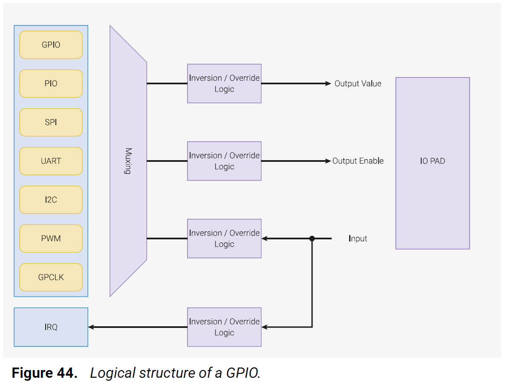
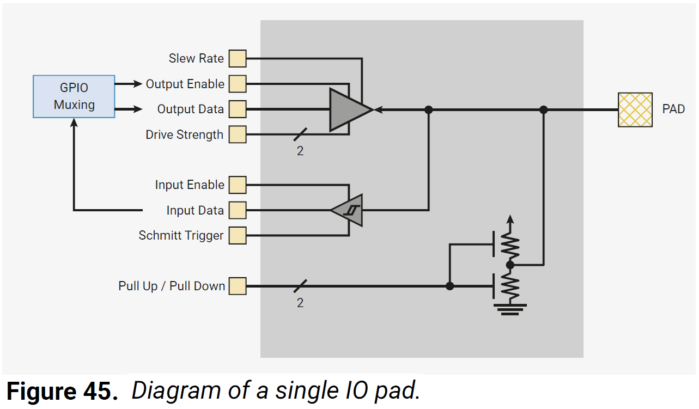

# LED 点滅プログラム
Raspberry Pi Pico 2 Wのピン配置は以下となっています。GPIO番号(図中、GPnn(nnは数字)と表記)をよくご確認ください。
<br>

物理的なピン番号とGPIO番号を間違いやすいのでご注意ください。物理的なピン番号は四角で囲って数字を書いています。
MicroPythonで指定する場合は、全てGPIO番号です。LEDはGP16（物理ピン番号21番）に接続します。LEDが点灯するかREPLで試しましょう

#### 回路図
<br>
#### 実体配線図
ご参考に実体配線図も示します。押しボタンスイッチはどの端子がOn/Offされるのか分かりづらいので取り付け方にご注意ください。
<br>

GP16を出力用に初期化するコードは以下です。REPLにより対話的に実行してみましょう。もしエラーが出ている場合はご連絡ください。
```
from machine import Pin
led = Pin(16, Pin.OUT)
```
点灯、消灯するプログラムは以下です。
```
led.on()
led.off()
```
REPLから入力するとLEDが点灯、消灯することが確認できます。

押しボタンスイッチはGP15に接続します。
GP15を入力用に初期化するコードは以下です。通常はスイッチをプルアップしておき、押されたらGNDに接続する回路を組むと思います（逆のプルダウン設計もあります）。GPIOにはプルアップ回路が内蔵されていますので、GPIO側でプルアップにしておくことで、外付けのプルアップ用抵抗の取付を省略できます。なお、RP2350のGPIOには設計上の問題があり、内蔵プルダウンが想定通りに動かない場合があります。プルアップで実装するのをお勧めします。
```
from machine import Pin
sw = Pin(15, Pin.IN, Pin.PULL_UP)
```
押しボタンを押して値が0になるか確認しましょう
```
sw.value()
```

押されている時はLEDが点灯するプログラム（部分）は以下です。
スイッチの値を取得して、値が0であれがGNDに接続されている(押されている)と判断できます。
0の時は押されている時ですのでLEDを点灯させます。それ以外はLEDを消します。
```
while True:
    print(sw.value())
    if sw.value() == 0:
        led.on()
    else:
        led.off()
```
これまでは部分的にREPLを使ってコードを追加しながらプログラムしました。全体をまとめた押しボタンスイッチ（GP15）を押している間だけLED（GP16）を点灯するプログラムは以下の通りです。

file:2-2-f-blink.py
```
#
# file:2-2-f-blink.py
# 概要: 押しボタンスイッチの入力に応じてLEDを点灯/消灯する基本プログラム
#
from machine import Pin

# setup
led = Pin(16, Pin.OUT)
sw = Pin(15, Pin.IN, Pin.PULL_UP)

# loop
while True:
    print(sw.value())
    if sw.value() == 0:
        led.on()
    else:
        led.off()
#
#
```
### 捕捉説明
GPIO とは General-Purpose Input/Output（汎用入出力）の略称です。汎用というのは、各GPIO Pin(PAD)に対して、UART、 I2C、SPI等、複数の機能から一つを切り替えて使えるためです。<br>
<br>
どの機能をどのPinに割り当てるのか、自由に割り当てられるのではなく、上記図の通り、各Pinには選択できる機能が決められています。Pin配置の図を見て、目的の機能を選択できるPinを選んでデバイスを接続する必要があります。

#### GPIO構成図
以下はGPIOの構成を表した図です。GPIO内に機能を選択するセレクタ(図中Muxing)があり、PADにどの機能を割り当てるか選ぶことができます。MicroPythonからGPIOを使う上で、機能選択は自動的に行われており機能の切り替えを意識する必要はありません。
GPIO構成図中にGPIOという名のブロックがありますが、これはマイコン側からL/Hのレベル設定を行えるSIO(Single-cycle IO)とご理解ください<br>
<br>
#### IOパッド構成図
以下はIOパッドの構成図です。PULL UP/PULL DOWN用抵抗が接続されていることが分かります。


Raspberry Pi | RP2350 Datasheetより引用

#### GPIO のプルダウン問題
RP2350-E9 erratumで示されるように、RP2350のGPIOに回路上の問題があり、GPIO入力パッドは一度Highになると約2.1V付近でラッチ（保持）される寄生リーク電流の問題があります。ラッチ状態を解除してLowに戻すには低い抵抗値による強いプルダウンが必要です(自分が試した結果では、内蔵プルダウンだけではLに落ちず、Hに張り付いたままでした)。
- [RP2350 Datasheet(Errata - RP2350-E9) (Appendix D: D.5. GPIO D.5.1. RP2350-E9)(PDF)](https://pip.raspberrypi.com/documents/RP-008373-DS-rp2350-datasheet.pdf)
