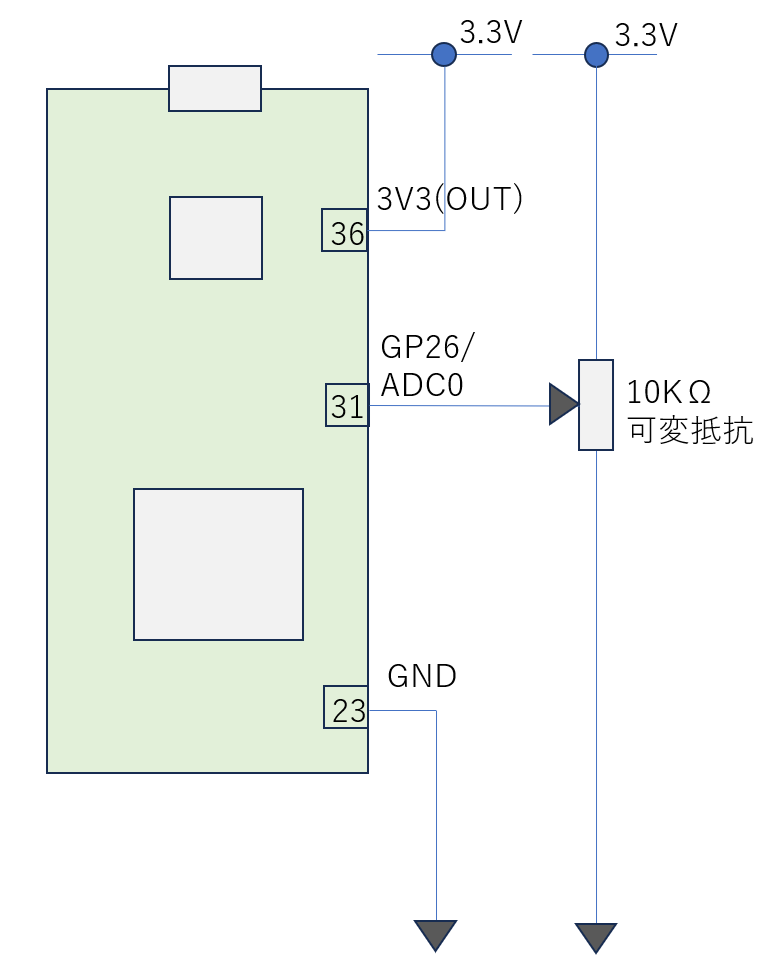

# アナログ値の取り扱い

GP26のADC0を使用します。ADCの初期化は以下です
```
from machine import ADC, Pin
adc = ADC(Pin(26))     # create ADC object on ADC pin
```
値を読み取ってみましょう
```
adc.read_u16()         # read value, 0-65535 across voltage range 0.0v - 3.3v
```
GP26にかかっている電圧が0Vの場合、adc.read_u16()の値は0になります。一方、電圧が3.3Vの場合、65535(0xffff)となります。
ADCを使うことにより0Vから3.3Vの間で変化する電圧を数値化することができます。回路を変更して可変抵抗を使って0Vから3.3Vまでの電圧を発生させてみます。回路図は以下です



上記回路図において、可変抵抗を回転させると、可変抵抗の中央の端子は０Vから3.3Vまで変化します。この電圧がGP26/ADC0にかかります。マイコンではAD変換により、かかっている電圧を0-65535の値で表現します。
アナログ値を取得して一定周期でprintするプログラムとしてまとめると以下です
```
from machine import ADC, Pin
import time
adc = ADC(Pin(26))     # create ADC object on ADC pin

while True:
    value = adc.read_u16()
    print(value, hex(value))
    time.sleep(0.5)
```
推定電圧も含めたサンプルコードは以下
```
from machine import ADC, Pin
import time
MAX_VALUE = 0xffff
MAX_VOLT = 3.3
adc = ADC(Pin(26))     # create ADC object on ADC pin

while True:
    value = adc.read_u16()
    estim_vol = MAX_VOLT * value / MAX_VALUE
    print(value, hex(value), estim_vol, 'V')
    time.sleep(0.5)
```
抵抗を操作して、AD変換された結果と推定される電圧を確認しましょう。このように、ボリュームの軸の回転に応じてAD変換された結果が変化します。この結果を使ってサーボモータや、LEDの明るさ、色合いを変更することで、ユーザのボリューム操作と、表示装置の連動が可能になります。
