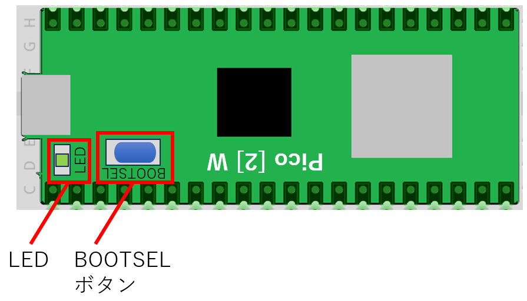
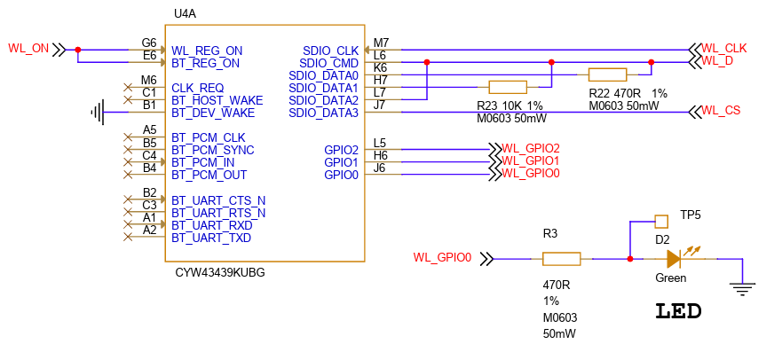
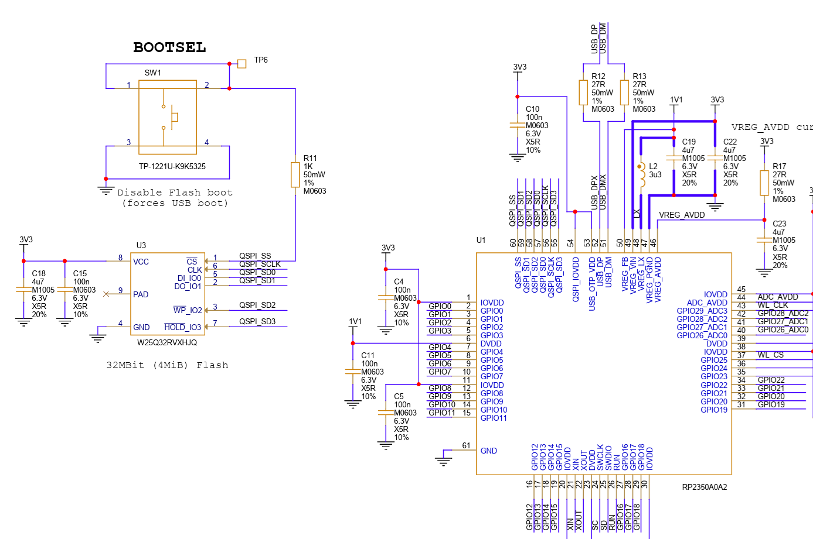

# ２－３ 参考：最もシンプルなLED点滅
Raspberry Pi Pico 2 W(略称、Pico2W)のボード上にはLEDが実装されておりプログラムから点灯、消灯を制御できます。



ボード上のLEDを点滅させるプログラムは以下です。`time.sleep(1)`により1秒待たせています。
```
from machine import Pin
import time

# setup for LED Pin
led = Pin('LED', Pin.OUT)

# loop; LED blink
while True:
    led.on()
    time.sleep(1)
    led.off()
    time.sleep(1)
```
また、ボード上にはBOOTSELボタンがあります。このボタンは起動時のモードを指定するために使いますが、起動後は押しボタンスイッチとして使うことができます。BOOTSELボタンに連動してLEDが点灯するプログラムは以下。

file : [src/2-3-f-simple-blink.py](src/2-3-f-simple-blink.py)
```
#
# file:2-3-f-simple-blink.py
# 概要: ボード上の押しボタンスイッチの入力に応じてボード上のLEDを点灯/消灯するプログラム
#
from machine import Pin
from rp2 import bootsel_button

# setup for LED Pin
led = Pin('LED', Pin.OUT)

# loop; LED on if button is pressed
while True:
    if bootsel_button() == 1:
        led.on()
    else:
        led.off()
```
上記いずれも配線が不要ですぐに使えるLEDとスイッチです。

ご参考にボードの配線図を付けます。Pico2WのオンボードLEDはGPIOに接続されておらず、ワイヤレス用チップに接続されています。このため単純なGP番号では指定できず、Pin関数の引数に'LED'を指定する必要があります。

LEDの配線図（Wi-Fiコントローラ配下に接続）



BOOTSELの配線図（マイコン・RP2350のQSPI_SS用のピンに接続）




