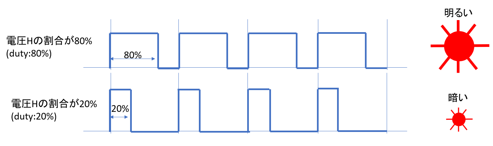
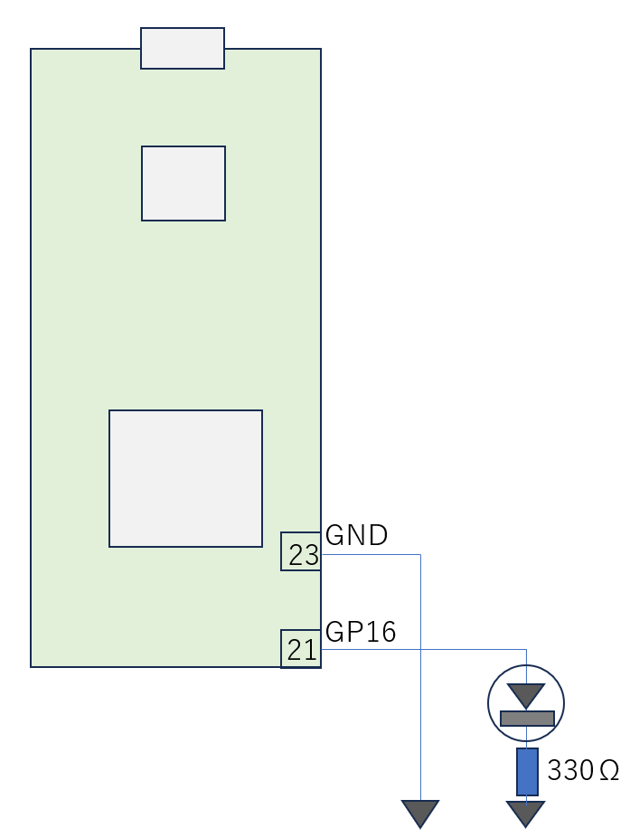
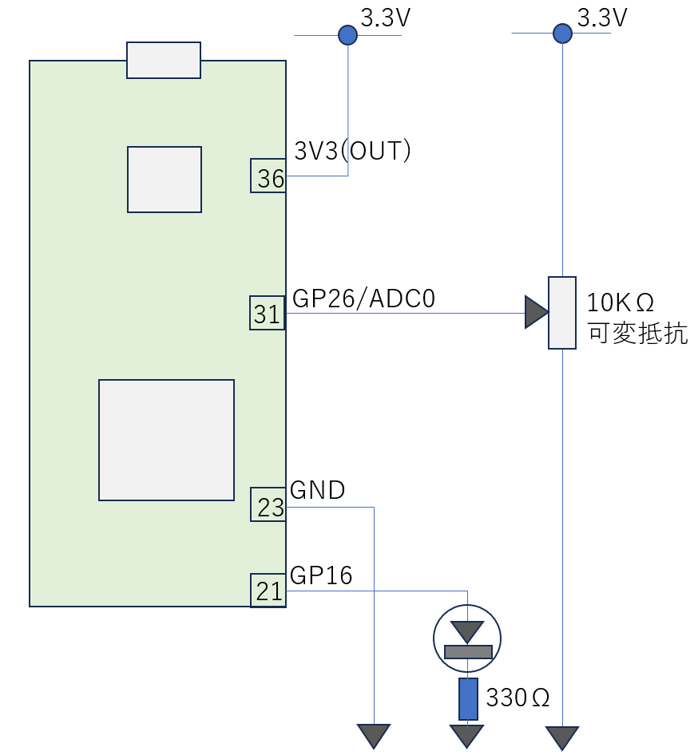

# PWMによる疑似アナログ出力

RP2Wに搭載されているマイコン：RP2350にはDA変換が搭載されていませんので、直接アナログ出力することができません。代替手段として、PWM(Pulse Width Modulation)を用いて、0、1(3.3V)以外の値（中間値）を表現することができます。

もう少し詳しく説明します。PWM信号とは、0Vと一定電圧（RP2Wの場合3.3V）のパルス列であり、指定したデューティ比によってパルス幅を制御できます。生成されたPWM信号を、ローパスフィルタ（LPF）に通すと、パルスの変動が平滑化され、デューティ比に応じた電圧を取り出せます。これをアナログ電圧のように利用できます。この講習では、LPFは使わず、そのままデバイスに投入します。

PWMを使うことでLEDをぼんやりと薄暗く光らせることができます。



これまでと同じようにLEDを点灯させる回路を組んでください。



PWMを使ってPWMの設定可能な最も低い周波数(8Hz @システムクロック125MHz)、duty:50%で点滅させるプログラム
```
import machine
from machine import Pin
from machine import PWM
PWM_OUTPUT_PIN=16

# setup
machine.freq(125_000_000)
# set lowest PWM FREQ 8Hz
pwm0 = PWM(Pin(PWM_OUTPUT_PIN), freq=8, duty_u16=int(0xffff/2))
```

PWMを使ってLEDを中間的な明るさで点滅させるプログラム
```
from machine import Pin
from machine import PWM
import time
LED_PIN=16

# setup
pwm0 = PWM(Pin(LED_PIN), freq=2_000, duty_u16=int(0xffff/4))

# loop
while True:
    pwm0.duty_u16(0xFFFF)
    time.sleep(1)
    pwm0.duty_u16(int(0xffff/4))
    time.sleep(1)
#
#
```

sin関数を使って周期的に明滅するプログラム<br>
sin関数は、半周するのに0からπまでの値を取ります。一方、Pythonのrange()は小数点を使えないので、ループ時の変数は、0 -> 314 で代用しています
```
from machine import Pin
from machine import PWM
import math

import time
MAX_VALUE = 0xFFFF
LED_PIN=16
# setup
pwm0 = PWM(Pin(16), freq=2000, duty_u16=0)  # setup PWM

# loop
while True:
    for i in range(0, 314 , 1):  # 314 means math.pi * 100
        value = int(MAX_VALUE * math.sin(i/100))    # i/100 means math.pi * 100 -> math.py
        pwm0.duty_u16(value)
        time.sleep(0.01)
#
#
```
### ボリュームの回転に合わせてLEDの明るさを調整
先ほどのボリュームと連動して明るさを調整するプログラムを作りましょう。可変抵抗とLEDを以下の配線図に従って結線してください。



VRの値に連動してLEDの明るさを変化させるプログラムは以下です。

```
from machine import Pin
from machine import ADC
from machine import PWM

import time
MAX_VALUE = 0xffff
MAX_VOLT = 3.3

VR_PIN=26
LED_PIN=16

# setup
adc = ADC(Pin(VR_PIN))     # create ADC object on ADC pin
pwm0 = PWM(Pin(LED_PIN), freq=2000, duty_u16=0)  # setup PWM

# loop
while True:
    value = adc.read_u16()
    pwm0.duty_u16(value)
    estim_vol = MAX_VOLT * value / MAX_VALUE
    print(value, hex(value), estim_vol, 'V')

#
#
```


参考WebPage<br>
https://micropython-docs-ja.readthedocs.io/ja/latest/rp2/quickref.html#pwm-pulse-width-modulation<br>
https://micropython-docs-ja.readthedocs.io/ja/latest/library/machine.PWM.html
