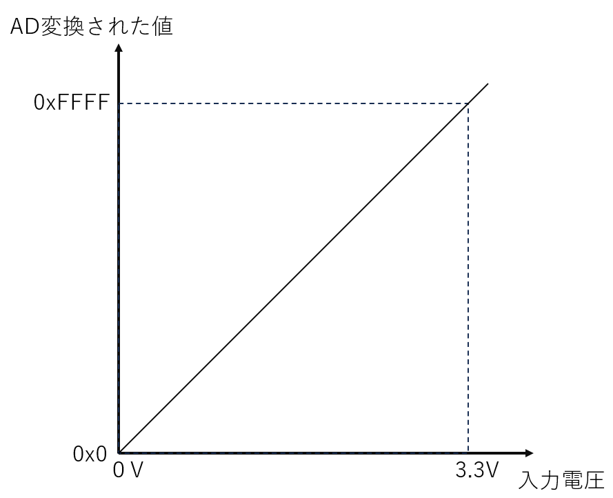
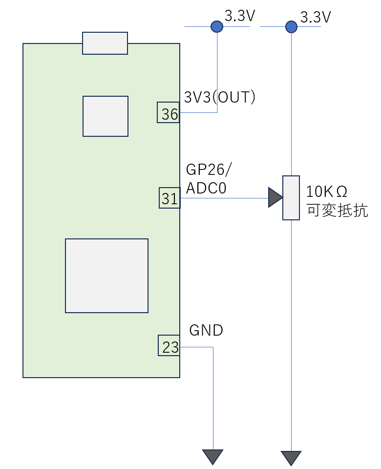

# 2-4 アナログ値の取り扱い（入力編）

RP2350にはアナログで入力された値をデジタル値に変換するアナログデジタルコンバータ(ADC)が搭載されています。ADCは3チャンネル搭載されています(ADC0, ADC1, ADC2)。

今回はADC0(GP26)を使用します。ADCの初期化は以下です。
```
from machine import ADC, Pin
adc = ADC(Pin(26))     # create ADC object on ADC pin
```
GP26（物理ピン番号は31番ピン）に対して0V(GND)か3.3Vに接続してADC変換された値を読み取ってみましょう。
```
adc.read_u16()         # read value, 0-65535 across voltage range 0.0V - 3.3V
```
GP26に0Vの電圧がかかっている場合、adc.read_u16()の値は0になります。一方、3.3Vの電圧がかかっている場合、adc.read_u16()の値は65535(0xffff)になります。<br>
<br>
ADCを使うことにより0Vから3.3Vの間で変化する電圧を数値化することができます。回路を変更して可変抵抗を使って0Vから3.3Vまでの電圧を発生させてみます。回路図は以下です。可変抵抗にかける電圧は3.3Vを使ってください。誤って5Vを接続しないように注意してください。



上記回路図において、可変抵抗を回転させると、可変抵抗の中央の端子は0Vから3.3Vまで変化します。この電圧がGP26/ADC0にかかります。マイコンではAD変換により、かかっている電圧を0-65535 ( 0xffff ) の幅の値で表現します。
アナログ値を取得して一定周期でコンソール画面に出力するプログラムとしてまとめると以下です

file : [src/2-4-f-adc-sample.py](src/2-4-f-adc-sample.py)
```
#
# file: 2-4-f-adc-sample.py
# 機能：可変抵抗（ボリューム）で設定された電圧をAD変換、変換結果を表示するサンプル
#
from machine import ADC, Pin
import time
adc = ADC(Pin(26))     # create ADC object on ADC pin

while True:
    value = adc.read_u16()
    print(value, hex(value))
    time.sleep(0.5)
```
推定電圧も含めたサンプルコードは以下です。

file : [src/2-4-f-adc-volt.py](src/2-4-f-adc-volt.py)
```
#
# file: 2-4-f-adc-volt.py
# 機能：ボリュームで設定された電圧をAD変換し、値と推定電圧を表示するサンプル
#
from machine import ADC, Pin
import time
MAX_VALUE = 0xffff
MAX_VOLT = 3.3
adc = ADC(Pin(26))     # create ADC object on ADC pin

while True:
    value = adc.read_u16()
    estim_vol = MAX_VOLT * value / MAX_VALUE
    print(value, hex(value), estim_vol, 'V')
    time.sleep(0.5)
```
抵抗を操作して、AD変換された結果と推定される電圧を確認しましょう。このように、ボリュームの軸の回転に応じてAD変換された結果が変化します。この結果を使ってサーボモータや、LEDの明るさ、色合いを変更することで、ユーザのボリューム操作と、表示装置の連動が可能になります。
