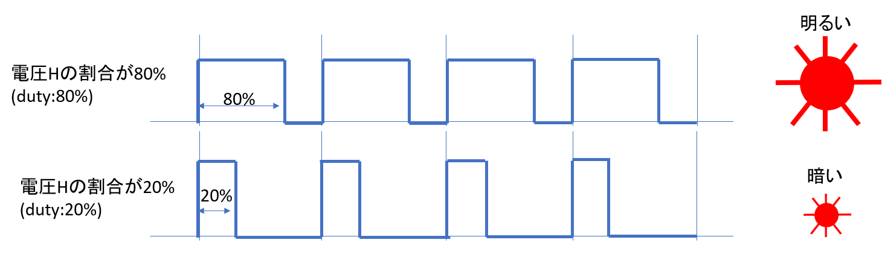
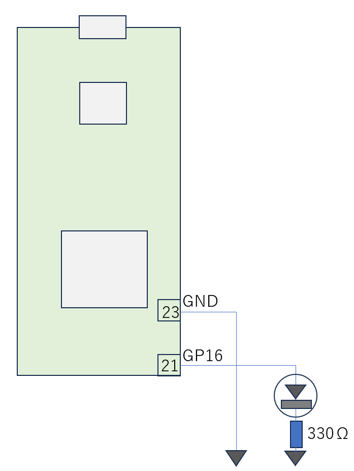
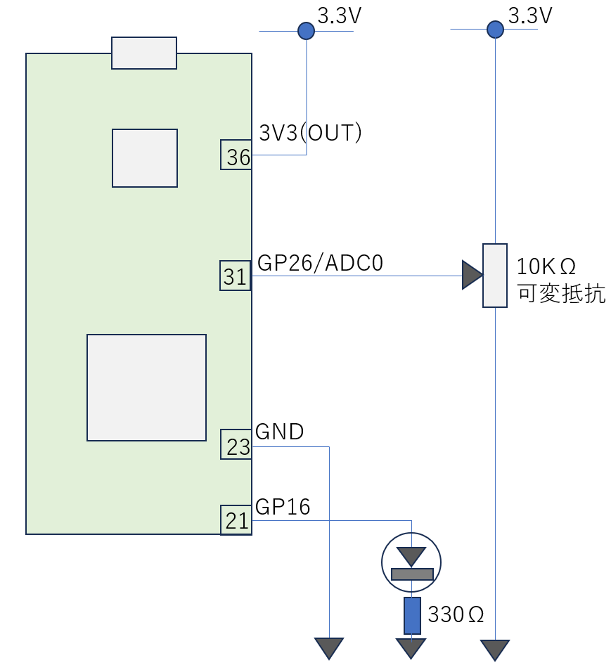

# 2-5 PWMによる疑似アナログ出力

Pico2Wのマイコン：RP2350にはデジタルアナログコンバータ（DA変換器）が搭載されていませんので、GPIOからアナログ出力することができません。代替手段として、PWM(Pulse Width Modulation)を用いることで、0、1(3.3V)以外の中間値を表現することができます。

もう少し詳しく説明します。PWM信号とは、0Vと一定電圧（Pico2Wの場合3.3V）のパルス列であり、指定したデューティ比によってパルス幅を制御できます。生成されたPWM信号を、ローパスフィルタ（LPF）に通すと、パルスの変動が平滑化され、デューティ比に応じた電圧を取り出せます。これをアナログ電圧のように利用できます。この講習では、LPFは使わず、そのままデバイスに投入します。

PWMを使うことでLEDをぼんやりと薄暗く光らせることができます。



MicroPythonにはPWMを簡単に取り扱うための関数が用意されています。

これまでと同じようにLEDを点灯させる回路を組んでください。



PWMを使ってPWMの設定可能な低い周波数(8Hz @システムクロック125MHz)、duty:50%で点滅させるプログラムは以下です。

file : [src/2-5-f-led-blink-pwm.py](src/2-5-f-led-blink-pwm.py)
```
#
# file: 2-5-f-led-blink-pwm.py
# 機能：PWMの最低周波数(8Hz @125MHz)とデューティ比50%でLEDを点滅させるサンプル
#
import machine
from machine import Pin
from machine import PWM
PWM_OUTPUT_PIN=16

# setup
machine.freq(125_000_000)
# set lowest PWM FREQ 8Hz
pwm0 = PWM(Pin(PWM_OUTPUT_PIN), freq=8, duty_u16=int(0xffff/2))
```

PWMを使ってLEDを中間的な明るさで点滅させるプログラムは以下です。

file : [src/2-5-f-led-dimming-pwm.py](src/2-5-f-led-dimming-pwm.py)
```
#
# file: 2-5-f-led-dimming-pwm.py
# 機能：PWMのデューティ比を切り替えてLEDの明るさ（100%と25%）を変化させるサンプル
#
from machine import Pin
from machine import PWM
import time
LED_PIN=16

# setup
pwm0 = PWM(Pin(LED_PIN), freq=2_000, duty_u16=int(0xffff/4))

# loop
while True:
    pwm0.duty_u16(0xFFFF)
    time.sleep(1)
    pwm0.duty_u16(int(0xffff/4))
    time.sleep(1)
```

sin関数を使って周期的に明滅するプログラム<br>
sin関数は、１周するのに0から2πまでの値を取ります。一方、Pythonのrange()は小数点を使えないので、ループ時の変数は、0 -> 314 で代用し、sin関数に渡す時に1/100で元の値に戻しています。

file : [src/2-5-ex-led-blink-pwm-sin.py](src/2-5-ex-led-blink-pwm-sin.py)
```
#
# file: 2-5-ex-led-blink-pwm-sin.py
# 機能：sin関数を使ってPWMのデューティ比を連続変化させ、LEDを滑らかに明滅させるサンプル
#
from machine import Pin
from machine import PWM
import math

import time
MAX_VALUE = 0xFFFF
LED_PIN=16
# setup
pwm0 = PWM(Pin(16), freq=2000, duty_u16=0)  # setup PWM

# loop
while True:
    for i in range(0, 314 , 1):  # 314 means math.pi * 100
        value = int(MAX_VALUE * math.sin(i/100))    # i/100 means math.pi * 100 -> math.pi
        pwm0.duty_u16(value)
        time.sleep(0.01)
```
### 演習：ボリュームの回転に合わせてLEDの明るさを調整
先ほどのボリュームと連動して明るさを調整するプログラムを作りましょう。可変抵抗とLEDを以下の配線図に従って結線してください。



VRの値に連動してLEDの明るさを変化させるプログラムは以下です。

file : [src/2-5-ex-led-control-vr-pwm.py](src/2-5-ex-led-control-vr-pwm.py)
```
#
# file: 2-5-ex-led-control-vr-pwm.py
# 機能：ボリューム（可変抵抗）のAD変換値に連動してPWMのデューティ比を変え、LEDの明るさを調整するサンプル
#
from machine import Pin
from machine import ADC
from machine import PWM

import time
MAX_VALUE = 0xffff
MAX_VOLT = 3.3

VR_PIN=26
LED_PIN=16

# setup
adc = ADC(Pin(VR_PIN))     # create ADC object on ADC pin
pwm0 = PWM(Pin(LED_PIN), freq=2000, duty_u16=0)  # setup PWM

# loop
while True:
    value = adc.read_u16()
    pwm0.duty_u16(value)
    estim_vol = MAX_VOLT * value / MAX_VALUE
    print(value, hex(value), estim_vol, 'V')
    time.sleep(0.01)
```


#### 参考資料
- https://micropython-docs-ja.readthedocs.io/ja/latest/rp2/quickref.html#pwm-pulse-width-modulation
- https://micropython-docs-ja.readthedocs.io/ja/latest/library/machine.PWM.html
