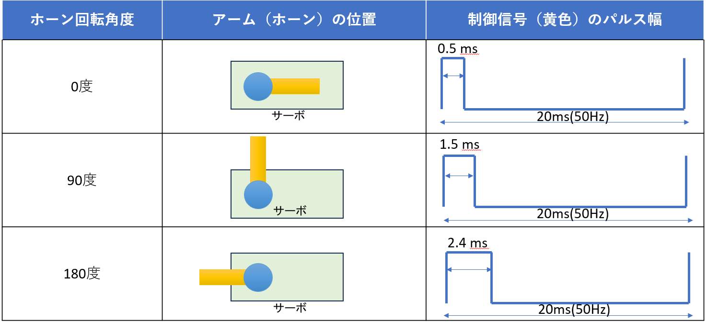
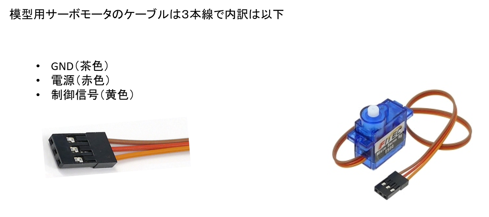
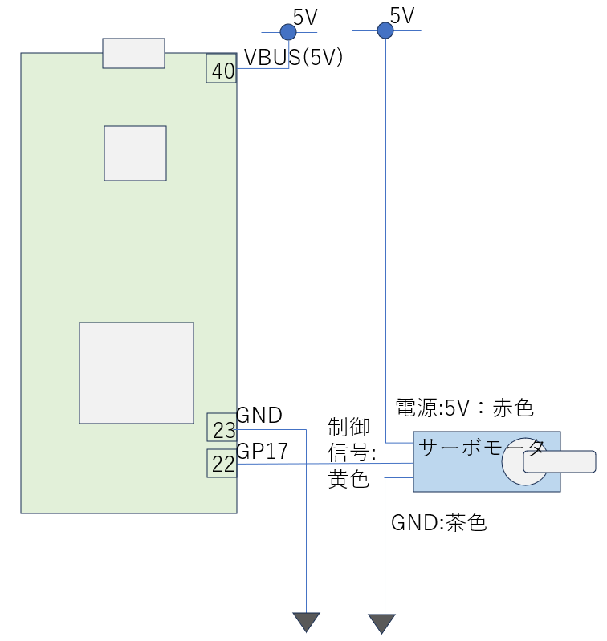
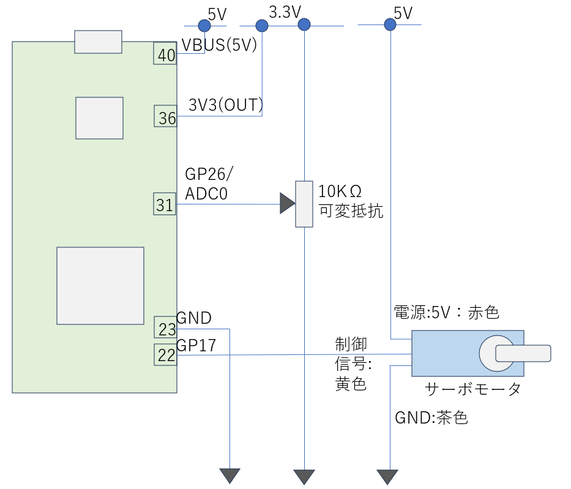

# 2-6 PWMによるサーボ制御

サーボモータのケーブルは、電源(5V)、GND、制御信号の３本で構成されます。制御信号はデジタル信号であり、ハイレベルのパルス幅によりサーボのホーンの回転角が決まります。パルス幅とホーンの回転角度は以下の仕様になっています。

PWMを使うことで、サーボを簡単に制御できます。メータのインジケータとしてサーボのホーンを使うことで、疑似的にアナログ値を表現することができます。下記は実際に動かして調整した数値です。

- サーボ制御パルスの仕様（一例）
  - 周波数：50Hz（周期20ms）
- パルス幅（HIGH時間）：
  - 最小角度（0°） : 約0.5ms
  - 中央（90°） : 約1.5ms 
  - 最大角度（180°） : 約2.4ms
 
<br>

 ご注意：周期は50Hz固定で問題ありませんが、パルス幅と角度の関係はサーボの種類により微調整が必要です。実際に動かしながら最適値を探してください。

基本的にサーボモータは電源電圧5V、制御信号5Vで設計されていますが、制御信号が3.3Vでもハイレベルと認識される仕様の機種もあります。

サーボモータの結線
- 赤：5V
- 茶：GND(0V)
- 橙：制御信号(PWM)(3.3V)

<br>


サーボとの接続回路を以下に示します。サーボの電源は5Vを供給します。ピン番号40番のVBUSからサーボに5Vを供給しています。VBUSはUSBから供給される５V電源に直結されており、5Vを供給できます。VSYSから電源供給することも可能ですが、VSYSの場合、逆流防止ダイオードを介してUSBの5Vと接続されており、若干電圧降下が発生します。



```
from machine import Pin
from machine import PWM
servo = PWM(Pin(17), freq=50)
```
ホーンの角度はPWMのdutyによって変えることができます。基本的な仕様では、角度に応じて、0度：1ms - 90度：1.5ms - 180度：2msとなっていますが、以下のサンプルコードは実際のサーボの動きを反映して設定値を最適化しています。
```
MAX_VALUE = 0xffff
servo.duty_u16(int(0.5/20 * MAX_VALUE))  # angle : 0 degree
servo.duty_u16(int(1.5/20 * MAX_VALUE))  # angle : 90 degrees
servo.duty_u16(int(2.4/20 * MAX_VALUE))  # angle : 180 degrees
```
指定された角度にアームを回転させるプログラム（関数化）は以下です。

file : [src/2-6-f-servo-rotate-PWM.py](src/2-6-f-servo-rotate-PWM.py)
```
#
# file: 2-6-f-servo-rotate-PWM.py
# 概要：PWMによるサーボ制御サンプルコード
#      アームの角度を0度から180度まで回転させる

#
# servo control function
#
from machine import Pin
from machine import PWM

# pulse width (ms)
DEGREE_0 = 0.5
DEGREE_180 = 2.4

PWM_FREQ_SERVO = 50  # 50Hz
MAX_VALUE = 0xffff
MAX_PULSE_WIDTH = 20 # max width : 20 ms in MAX_VALUE

SERVO_PIN = 17

def servo_rotate_horn(servo, degree):
    target_pulse_width = degree / 180 * (DEGREE_180 - DEGREE_0) + DEGREE_0
    servo.freq(PWM_FREQ_SERVO)  
    servo.duty_u16(int(target_pulse_width /MAX_PULSE_WIDTH * MAX_VALUE))

# test
import time
def servo_test():
    # initialize PWM for servo control
    servo = PWM(Pin(SERVO_PIN), freq=PWM_FREQ_SERVO)
    print('rotate 0 degree')
    servo_rotate_horn(servo, 0)
    time.sleep(1)
    print('rotate 45 degree')
    servo_rotate_horn(servo, 45)
    time.sleep(1)
    print('rotate 90 degree')
    servo_rotate_horn(servo, 90)
    time.sleep(1)
    print('rotate 135 degree')
    servo_rotate_horn(servo, 135)
    time.sleep(1)
    print('rotate 180 degree')
    servo_rotate_horn(servo, 180)
    time.sleep(1)
    print('rotate 90 degree')
    servo_rotate_horn(servo, 90)
    time.sleep(1)
    print('rotate 0 degree')
    servo_rotate_horn(servo, 0)

# サーボ回転開始
servo_test()
```

サーボ制御関数servo_rotate_horn() は共通ライブラリ、mylib.pyに入れています。
共通ライブラリ mylib.py  file: [src/lib/mylib.py](src/lib/mylib.py)

mylibにより提供される関数 servo_rotate_horn()を使うことでコードが短縮化できます。以下ソースコードのように利用できます。

file : [src/2-6-f-servo-sample-w-lib.py](src/2-6-f-servo-sample-w-lib.py)
```
#
# file : 2-6-f-servo-sample-w-lib.py
# 機能：mylib内で定義された servo制御関数、servo_rotate_horn()を使ったサンプルコード
#
from mylib import servo_rotate_horn
from mylib import PWM_FREQ_SERVO       # 50Hz

SERVO_PIN = 17
servo = PWM(Pin(SERVO_PIN), freq=PWM_FREQ_SERVO)
servo_rotate_horn(servo, 90)
```

### 演習：ボリュームの回転に合わせてサーボホーンを動かす

可変抵抗（ボリューム）とサーボモータを連動させることで、ボリュームの回転に合わせてサーボホーンを動かすことができます。仕組みとしては、ボリュームに応じた電圧変化をADCでデジタル化し、得られた値に応じてサーボに与えるパルス幅を変化させます。回路図は以下です。



ボリューム軸の回転に連動してサーボのホーンを動かすプログラムは以下です。

file : [src/2-6-ex-servo-volume-control.py](src/2-6-ex-servo-volume-control.py)
```
#
# file : 2-6-ex-servo-volume-control.py
# 機能：可変抵抗（ボリューム）のアナログ入力値をAD変換でデジタル化、得られた値をサーボの回転角度に変換して
#      サーボのホーンを回転させる
#
from machine import Pin
from machine import ADC
from machine import PWM
from mylib import servo_rotate_horn
from mylib import PWM_FREQ_SERVO

VR_INPUT_PIN = 26
SERVO_PIN = 17

adc = ADC(Pin(VR_INPUT_PIN))     # create ADC object on ADC pin
servo = PWM(Pin(SERVO_PIN), freq=PWM_FREQ_SERVO)

while True:
    vr = adc.read_u16() 
    degree = int(180 * vr / 0xffff)
    servo_rotate_horn(servo, degree)
```
調整点：サーボホーンが小刻みに揺れる症状（ジッター症状）が発生する場合、サーボモータの機械的応答時間を考慮して、ループ内に、time.sleep(0.1)程度の待機時間を設定してください。

### 参考資料
- https://micropython-docs-ja.readthedocs.io/ja/latest/esp8266/tutorial/pwm.html#control-a-hobby-servo
