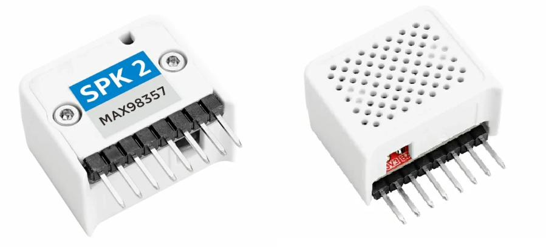
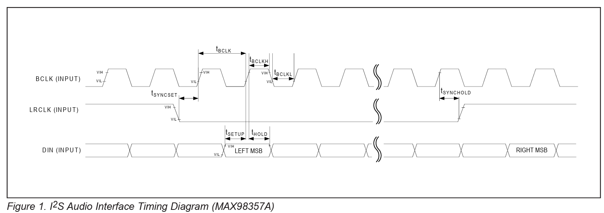
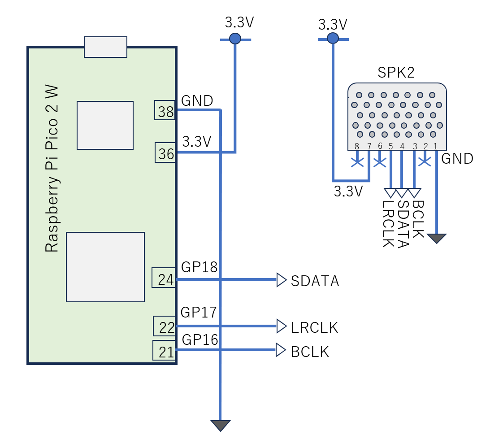

# I2SによるDAコンバータとの接続

非圧縮の音データを送受信するための仕様として、I2S (Inter-IC Sound)があります。これはNXPにより策定された仕様であり、下記の信号線で音データが送信されます。
- 16bit/24bit長の音データ : SD (SDATA)
- L/Rのいずれであるかを示すCLK: WS (LRCLK/WDCLK)
- 1bitの音信号を示すCLK:  SCK (SCLK)
- MasterClock (SYSCLK/MCLK)

https://en.wikipedia.org/wiki/I2S

I2Sは、DigitalMICやADC（Analog to Digital Converter）とマイコンの接続、マイコンとDAC（Digital to Analog Converter）との接続で使われます。<br>
I2Sを用いてデバイスと接続する場合、I2Sで規定される信号線の仕様に加え、IS2上で送受信するデータの表現形式（データフォーマット）を考慮する必要があります。データ表現形式は、DAC等のデバイスによって決まります。例えば、I2Sで制御できるスピーカ、M5StickC Plus用 Speaker 2 Hatには、MAX98357デジタルオーディオが搭載されています。<br>
<br>
https://shop.m5stack.com/products/m5stickcplus-speaker-2-hat-max98357　より引用

MAX98357はI2S形式でデジタル音声信号を入力することができる、DAC機能内蔵の小型D級アンプICです。I2Sのバス仕様は以下<br>
<br>
[DataSheet](https://www.analog.com/media/en/technical-documentation/data-sheets/max98357a-max98357b.pdf) より引用

MAX98357の仕様は、サンプリングレートは 8kHz ～ 96kHzであり、1音のビット幅（データ解像度）はI2S / 左詰めモード時、 16ビット、24ビット、32ビットに対応できます。どのようなレート、ビット幅かは、DAC側で自動判別します。



#### サンプルコード（１）
440Hzの音を段々大きくしながら再生するプログラム。サンプリングレート 8KHz、ビット幅16bitで音データを作成して、I2Sを使ってSpeaker2にデータ送信
```
#
# i2s sin wave play test 
# ok  (signed value)
#

#
#original source:
#   https://github.com/miketeachman/micropython-i2s-examples/blob/master/examples/play_tone.py
#

import os
import time
import math
import array
from machine import Pin
from machine import I2S

SCK_PIN = 16
WS_PIN = 17
SD_PIN = 18
I2S_ID = 0
BUFFER_LENGTH_IN_BYTES = 1024

SAMPLE_RATE_IN_HZ = 8_000      # The lowest supported sample rate of MAX98357
SAMPLE_SIZE_IN_BITS = 16       #  16bit/sound
FORMAT = I2S.MONO              # only MONO supported in this example
FREQ_A440 = 440

#
# create a buffer containing the pure tone samples
#

MAX_VOLUME = 0xff

def make_tone_signed_16b(rate, frequency, volume):
    samples_per_cycle = rate // frequency
    samples = array.array('h', [0] * samples_per_cycle)  # 'h' : signed short (2bytes)
    # value_range : max value of posivtive value  ; -tone_value_range -- 0 -- +tone_value_range
    tone_value_range = (pow(2, (SAMPLE_SIZE_IN_BITS - 1)) - 1) * volume // MAX_VOLUME
    #print('tone_value_range', tone_value_range)
    for i in range(samples_per_cycle):
        samples[i] = int(tone_value_range * math.sin(2 * math.pi * i / samples_per_cycle))
    return samples


audio_out = I2S(
    I2S_ID,
    sck = Pin(SCK_PIN),
    ws = Pin(WS_PIN),
    sd = Pin(SD_PIN),
    mode = I2S.TX,
    bits = SAMPLE_SIZE_IN_BITS,
    format = FORMAT,
    rate = SAMPLE_RATE_IN_HZ,
    ibuf = BUFFER_LENGTH_IN_BYTES,
)

freq = FREQ_A440

for volume in range(0x00, 0xFF, 0x10):
    tone_data = make_tone_signed_16b(SAMPLE_RATE_IN_HZ, freq, volume)
    print(f'vol: {volume:02x}')
    print(tone_data)
    for _ in range(int(freq/8)):   # play for 0.12sec
        _ = audio_out.write(tone_data)
    time.sleep(1)

#machine.reset()
```
max98357a-max98357b仕様書<br>
https://www.analog.com/media/en/technical-documentation/data-sheets/max98357a-max98357b.pdf

https://github.com/foobarbazfred/Pico-MicroPython-Workshop/blob/main/3-Day1-Foundation/src/lib/I2S_sample4.py<br>
https://micropython-docs-ja.readthedocs.io/ja/latest/library/machine.I2S.html<br>
https://micropython-docs-ja.readthedocs.io/ja/latest/rp2/quickref.html#i2s-bus<br>
https://github.com/micropython/micropython/blob/master/ports/rp2/machine_i2s.c<br>
https://www.nxp.com/docs/en/user-manual/UM11732.pdf
