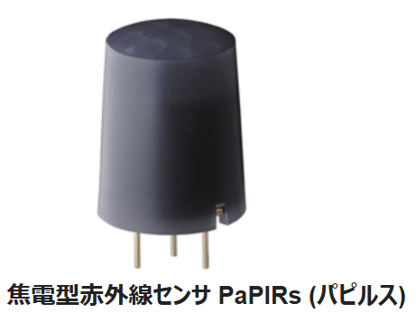

# 人感センサ(焦電型赤外線センサ)

人感センサを使うことで、人が近づいたことを検知することができます。例えば、以下は焦電型赤外線センサー PaPIRs(VZ) 5m EKMC1601112です。出力はデジタル１本のL/Hであり、人が近づいたら1(3.3V)になります。マイコン側からの設定等は不要です。<br>
<br>
PaPIRsのデジタル出力はFETドレイン出力（ハイサイドのオープンドレイン）です。未検知時の出力レベルをLowに確定させるためにセンサーの外側にプルダウン抵抗が必要です。出力最大電流が100μAなので、47kΩから100kΩの外付け抵抗でLowにPull Downします。回路図と簡単なテストプログラムは以下です
```
#
# test program for Pyroelectric Infrared Sensor
#
import time
from machine import Pin
PIR_SENSOR_PIN = 0

# setup
sensor_pin = Pin(PIR_SENSOR_PIN, Pin.IN)

# loop
while True:
    if sensor_pin.value() == 1:
        print('Detected')
    else:
        print('Not detected')
    time.sleep(1)

```
本来は上記回路とテストプログラムで動作するはずですが(RP2040 (Raspberry Pi Picoで動作確認済み))、RP2350-E9 erratumで示されるように、RP2350のGPIOに回路上の問題があり、GPIO入力パッドは一度Highになると約2.1V付近でラッチ（保持）される寄生リーク電流の問題があります。ラッチ状態を解除してLowに戻すには低い抵抗値による強いプルダウンが必要です。一方、人感センサーPaPIRsでは出力電流の上限が100μAと定められており33kΩ以上のプルダウン抵抗を選択する必要があります。このような理由により、外付け抵抗によるプルダウン機能は正しく動作しません。回避手段としては、センサとマイコンの間にMOSFETやトランジスタを介して、追加されたデバイスでプルダウンとL/Hの信号に変換してGPIOに信号を送る方法が考えられます。


### ご参考
* [RP2350 Datasheet(Errata - RP2350-E9) (Appendix D: D.5. GPIO D.5.1. RP2350-E9)](https://pip.raspberrypi.com/documents/RP-008373-DS-rp2350-datasheet.pdf)　
* [PaPIRs(VZ) 5m EKMC1601112仕様書](https://industrial.panasonic.com/cdbs/www-data/pdf/EWA0000/ast-ind-247460.pdf)
* [焦電型赤外線人感センサ Q&A集2025](https://industrial.panasonic.com/cdbs/www-data/pdf/EWA0000/ast-ind-250616.pdf)

