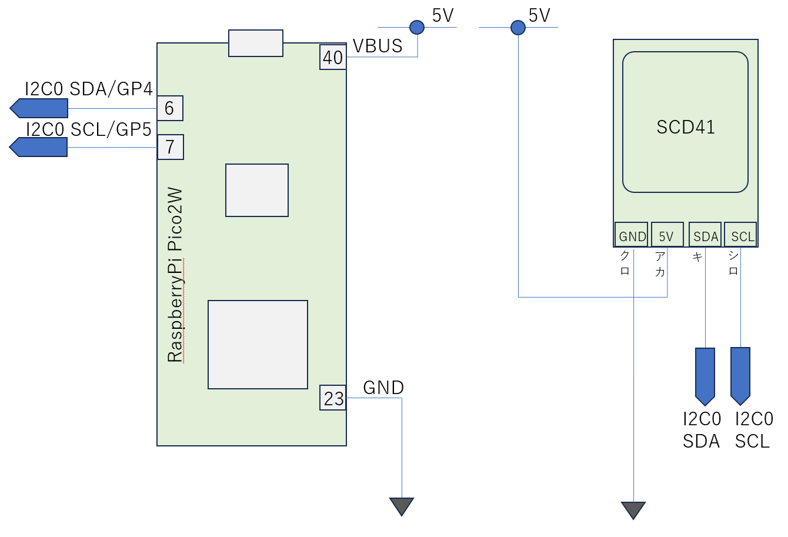

# CO2センサ(SCD41)を使う

Sensirion社製のCO2センサ(SCD41)を使ってCO2濃度を測ってみましょう。
SCD41は温度、湿度、CO2濃度が測定できる空気質センサです。I2Cによりセンサを制御します。一般的なセンサはレジスタ用のアドレスが割り振られていて、指定されたアドレスのレジスタにパラメータを書き込んだり、レジスタから値を読み込むことでデバイスとの通信を行います。Sensirionの場合、レジスタの概念がなく、コマンドの送受信でセンサを制御します。SCD41用のコンパクトなドライバがないので、今回は最小限のコードを書きました。

CO2センサの仕様
- センサデバイス：Sensirion SCD41
- 機能：温度、湿度、CO2濃度の測定
- 接続方法：I2C接続
   - デバイスアドレス： 0x62
   - メモリに割り当てられたレジストをリードライトするのではなく、センサに制御コマンドを送信して制御する

### 配線図


デバイス接続テスト
```
from machine import I2C
from machine import Pin
I2C_SDA = 4
I2C_SCL = 5
BUS=0
i2c = I2C(id=BUS, scl=Pin(I2C_SCL), sda=Pin(I2C_SDA), freq=20_000)
```
```
i2c.scan()
```
実行結果
```
>>> hex(i2c.scan()[0])
'0x62'
```

### SCD41用ドライバソフト
- Git上のドライバ置き場所 [src/lib/scd41.py](src/lib/scd41.py)
- MicroPython側での置き場所： /lib/sdc41.py

### MicroPythonへのインストール方法
1. mipによりGitHubからインストール
2. thonnyによりファイル保存することでインストール

mipを使ってGitHubからインストールする方法(MicroPythonのREPLで実行してください)
```
import mip
mip.install('https://raw.githubusercontent.com/foobarbazfred/Pico-MicroPython-Workshop/main/3-Day1-Foundation/src/lib/scd41.py')
```

libに配置したscd41モジュールを使うサンプルコード
```
from scd41 import *

# Sensor I2C Connection Pin Assign
I2C_SDA = 4
I2C_SCL = 5

def main():

    #
    # setup
    #
    
    # setup i2c bus for sensor
    i2c = I2C(0, scl=Pin(I2C_SCL), sda=Pin(I2C_SDA), freq=20_000)
    
    # >>> hex(i2c.scan()[0])
    # '0x62'
    
    init_sensor(i2c)
    time.sleep(5)        # wait until sensor is ready

    #
    # loop
    #
    
    while True:
        temp, hum, co2 = read_measurement(i2c)
        if temp is None:
            print(f"temp: --.-- C, hum: --.-- %, CO2: ---- ppm")           
        else:
            print(f"temp: {temp:.2f}C, hum: {hum:.2F} %, CO2: {co2} ppm")
        time.sleep(60)

if __name__ == '__main__':    
   main()    
    
```

### 参考資料
- Sensirion SDC41 Products
  - https://sensirion.com/jp/products/catalog/SCD41
- Sensirion SCD4x DataSheet
  - https://sensirion.com/media/documents/48C4B7FB/67FE0194/CD_DS_SCD4x_Datasheet_D1.pdf
- Sensirion Drvier
  - https://github.com/Sensirion/python-i2c-scd/tree/master/sensirion_i2c_scd/scd4x
