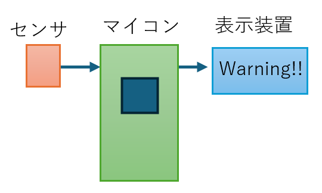
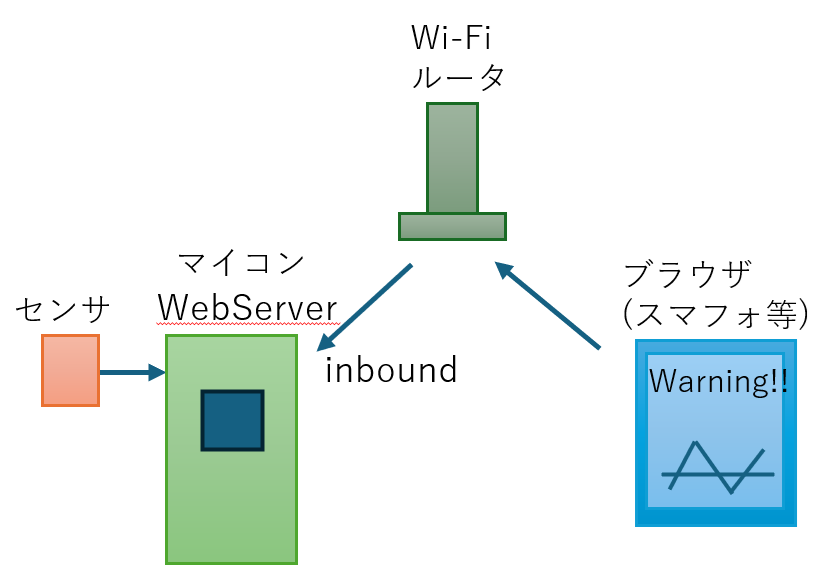
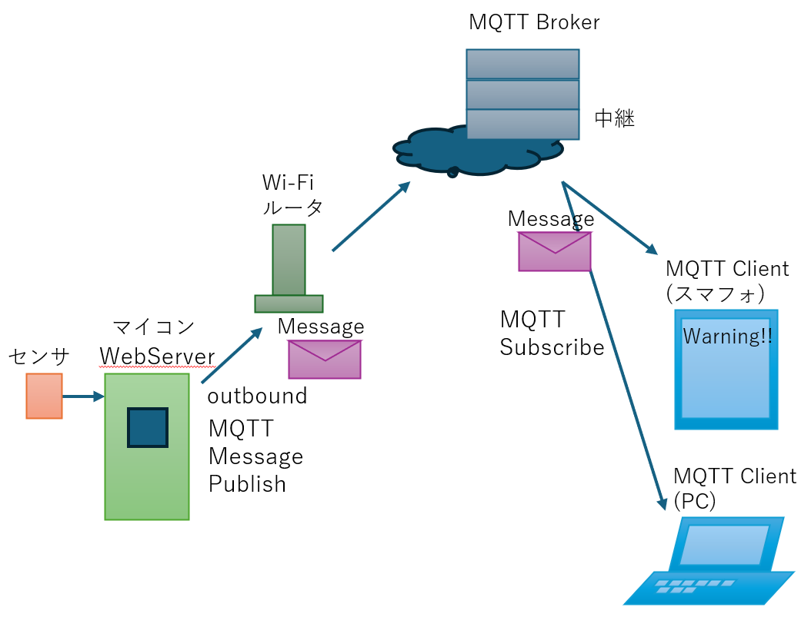
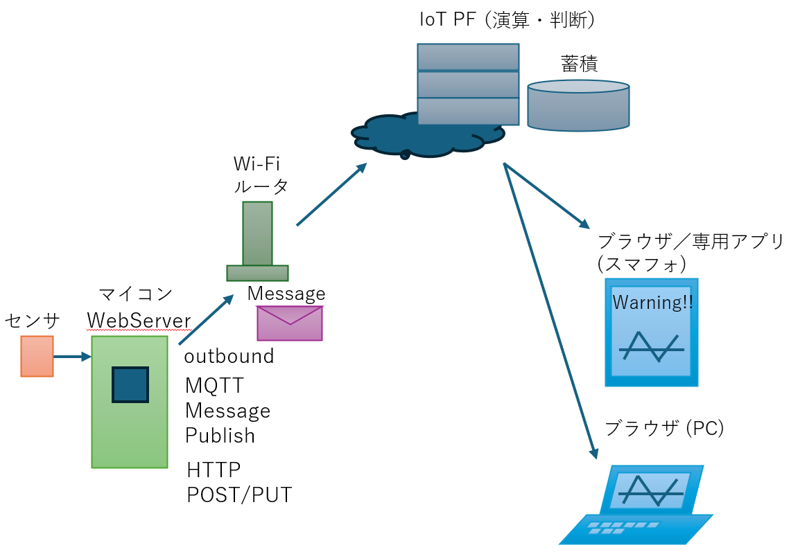

## 通信機能を持つマイコンシステムのデザインパターン

|パターン名|構成図|特徴|
|--|--|--|
|パターン０：マイコンとセンサ表示装置のみ| (図の矢印はデータ(情報)が流れる方向を示しています)|・ネットワーク接続なし、スタンドアロン動作 ・出力結果を得るためマイコン装置まで行く|
|パターン１：インターネット上のWebService(WebAPI)と連携、サービスを利用する| 注：この図の矢印はネットワークの接続方向を示しています|・Webサーバによりブラウザから閲覧可能 ・同一LAN内から複数メンバが出力結果参照可 ・努力次第でグラフ化可能(手作り) ・努力次第でブラウザからマイコン配下の機器制御可能(手作り)|
|パターン２：MQTT ブローカを介した情報発信と受信| (図の矢印はデータ(情報)が流れる方向を示しています)|・MQTT ブローカを介することで、遠隔地のメンバが参照可能 ・MQTT Clientによるデータ表示 ・JSによるデータビューア(手作り) ・マイコン側がMQTT Subscribeすることで遠隔からのメッセージを受信し、遠隔からマイコン配下のデバイスを制御可能|
|パターン３：IoT プラットフォームによるデータ蓄積、演算、判断| (図の矢印はデータ(情報)が流れる方向を示しています)|・IoT プラットフォームを契約してデータ蓄積、一覧化、演算、判断が可能 ・IoT プラットフォームによりアカウント管理可能|
|パターン４：Webサーバ機能を持つマイコン| 注：この図の矢印はネットワークの接続方向を示しています|・Webサーバによりブラウザから閲覧可能 ・同一LAN内から複数メンバが出力結果参照可 ・努力次第でグラフ化可能(手作り) ・努力次第でブラウザからマイコン配下の機器制御可能(手作り)|

### パターン０：マイコンとセンサ、表示装置だけで実現
- 構造：ネットワーク接続なし、スタンドアロンで動作させる
- セキュリティの観点で安全(ネットワーク経由での攻撃リスク低減)
- データの送信や遠隔からの制御は不可
- 機械学習や画像処理等の高度な判断は難しい
### パターン１：ネットワーク経由でインターネット上のWebServiceを利用
- 構造：マイコンのネットワーク機能を用いて天気予報サーバや各種情報提供サーバに接続、情報を取得する
- （上位ルータを適切に設定することで）マイコンへの接続(inbound)はローカルネットワークに限定
- マイコンから外部サーバに接続してデータを取得することも可能(outbound)
- ブラウザによる表示、ブラウザからの操作が可能
- 同一ネットワーク内であれば装置から離れた場所でも情報取得、制御可能
- 同一ネットワーク内からの不適切な利用(極端な連続アクセス等)を考慮
### パターン２：マイコンとセンサ、MQTT ブローカ、ブラウザ(MQTTクライアント)で実現
- 構造：マイコンにMQTTクライアントの機能を持たせてMQTTブローカにメッセージをPublish
- 適切な認証とアクセス制御を設定することで遠隔地からデータが参照可能(閲覧者はMQTTブローカにSubscribeする)
  - 特定のトピックに対するPublish/Subscribeのアクセス制限を設定することで、メッセージの発行、閲覧の制御が可能 
- データの表示はMQTTクライアントのみでも可能
- マイコンが特定のTopicをSubscribeすることで遠隔地からのデータ取得が可能
   - 遠隔地でPublishされた情報をマイコン側の出力装置で表示
   - 遠隔操作メッセージを受けてマイコン配下の機器を制御(インターネット越しにマイコン配下の機器が制御可能)
- 脆弱性を作りこまないよう、セキュリティ設計が必要
### パターン３：マイコンとセンサ、IoT プラットフォーム、ブラウザ（または専用アプリ）で実現
- 構造：IoT プラットフォーム(以降 IoT PF)を契約して測定データをIoT PFに送信する
  - コストを抑えるために、オープンソースによるIoT PFを立ち上げる方法もあります(ThingsBoard Community Edition) [機能比較表](https://thingsboard.io/ce-vs-pe-diff/)
- データの蓄積、演算、判断はIoT PF側で行う
   - １年以上の長期間にわたる大量のデータ蓄積が可能
   - 長期間の傾向を分析、今後の傾向が予測可能、去年の傾向と比較可能（植物の生育傾向等） 
   - 機械学習や画像処理等の高度な判断が可能（立ち入り監視、異常人物監視等）
- 有償のIoT PFを活用することで、サービス利用者の認証、認可が可能になる
- データやマイコン側のセキュリティもIoT PFの設計方針に従うことである程度守ることができる
### パターン４：ネットワーク接続できるマイコンとセンサ、ブラウザで実現
- 構造：マイコンにWebサーバ機能を持たせる
- （上位ルータを適切に設定することで）マイコンへの接続(inbound)はローカルネットワークに限定
- マイコンから外部サーバに接続してデータを取得することも可能(outbound)
- ブラウザによる表示、ブラウザからの操作が可能
- 同一ネットワーク内であれば装置から離れた場所でも情報取得、制御可能
- 同一ネットワーク内からの不適切な利用(極端な連続アクセス等)を考慮

## デザインパターンの選び方
- マイコン内の簡単な演算で処理が完結する場合や、データを参照する人が遠隔地でない場合はパターン０のスタンドアロンによる実装が望ましい（理由：プログラムがシンプル、セキュリティリスクが低い）
- 長期間のデータを保存、グラフ化、データに基づく分析、判断、通知、自動制御を実現する場合、IoT PFの利用が望ましい（パターン３）
- IoT PFを利用しない場合
   - マイコン側でSDカードを接続することで、長期データ蓄積も可能(パターン０) （注意：ストレージ故障、盗難、紛失のリスク） 
   - 同一LAN内の制限のもとで、ブラウザでグラフ表示する、ブラウザに描画されるスイッチで機器操作を試すならパターン１
   - インターネット越しに、MQTT Clientによるデータ表示させたい、あるいは、クライアント側でビューアを作ってグラフ化するならパターン２
   - MQTT メッセージを使ってインターネット越しにマイコン配下の機器を制御したい場合、パターン２(マイコン側でMQTT Subscribeしてメッセージを受信)(注意：ネットワークを介した攻撃への防衛) 
- なお、上記デザインパターンに含まれていませんが、WebAPIを呼び出してマイコン上のアプリと連携する場合、パターン２をベースに、MQTT ブローカへの接続ではなく、WebServerへの接続が必要になります。
