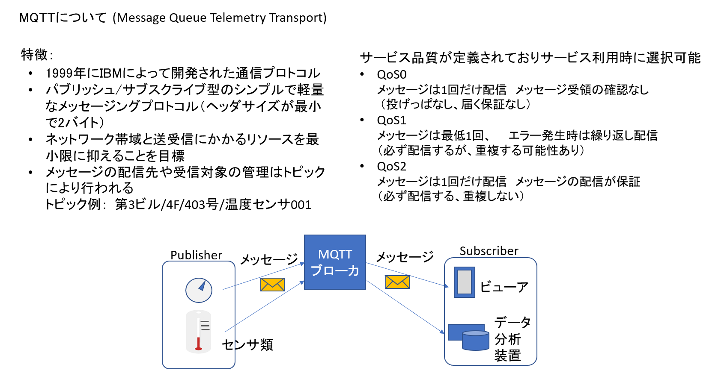
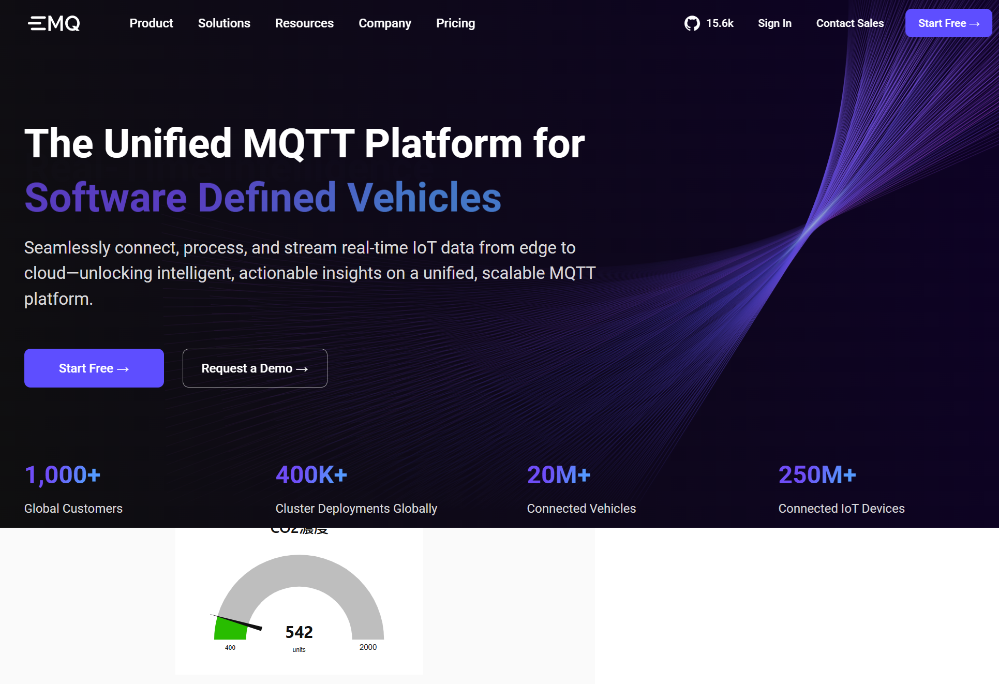

# MicroPythonでMQTTサービスを使う


MQTT(Message Queuing Telemetry Transport)を使うことで、複数拠点に配置したセンサデータの収集や、家庭内に設置した機器を遠隔から制御するアプリケーションが容易に実現できます。<br>

MQTTサービスを使うためには、MQTTメッセージを中継してくれるMQTTブローカが必要になります。通信する範囲がローカルネットワーク内で収まるのであれば、ラズパイ等にMQTT ブローカを構築することが可能です。インターネットを介して遠隔地とメッセージを送受信するには、インターネット上で運用されるMQTTブローカが必要です。
インターネット上で無料で運用されているMQTTブローカは複数ありますが、今回は比較的遅延の少ない、EMQXのPublicMQTTブローカを用います。<br>



### ご参考
使いやすいMQTTブローカを整理します
- HiveMQ
  - 無料で使えるPublic MQTT Brokerサービスがあります  https://www.mqtt-dashboard.com/
- EMQX
  - 無料で使えるPublic MQTT Brokerサービスがあります  https://www.emqx.com/ja/mqtt/public-mqtt5-broker
- Shiftr.io
  - 帯域制限ありますがアカウントを登録することで無料で使えます(Basic Planは0円)  https://www.shiftr.io/cloud
  - PrivateなMQTT Brokerです
  - Dashboardサービスがあり、Publisher/Describer間の通信状況を確認することができます

MicroPython 用のMQTTライブラリも存在し、MQTTを活用したアプリケーションを簡単につくることができます。
MicroPython用MQTTライブラリはリポジトリに登録されており、MicroPythonのMIPによりネットワーク経由でインストールすることができます。
1. まずmipモジュールをインポートします(REPL)
```
import mip
```
2. mip.install()関数を用いてumqtt.simpeをインストールします
```
mip.install('umqtt.simple')
```
上記操作によりMicroPythonのFlash(ファイルシステム)にumqtt.simpleがインストールされます。
以下は実行結果です
```
>>> import mip
>>> dir(mip)
['__class__', '__name__', 'const', '__dict__', '__file__', '__path__', 'sys', '_CHUNK_SIZE', '__version__', '_check_exists', '_chunk', '_download_file', '_ensure_path_exists', '_install_json', '_install_package', '_rewrite_url', 'allowed_mip_url_prefixes', 'install', 'requests']
>>> mip.install('umqtt.simple')
Installing umqtt.simple (latest) from https://micropython.org/pi/v2 to /lib
Copying: /lib/ssl.mpy
Copying: /lib/umqtt/simple.mpy
Done
```
ファイルが置かれたか確認します。以下の操作により、 Flash上のファイルシステム内、/lib/umqtt/simple.mpy' が置かれたことが分かります
```
>>> ls('lib')
    <dir> umqtt
      745 ssl.mpy
     2824 upysh.py
2,504k free
>>> ls('lib/umqtt')
     2529 simple.mpy
2,504k free
```


