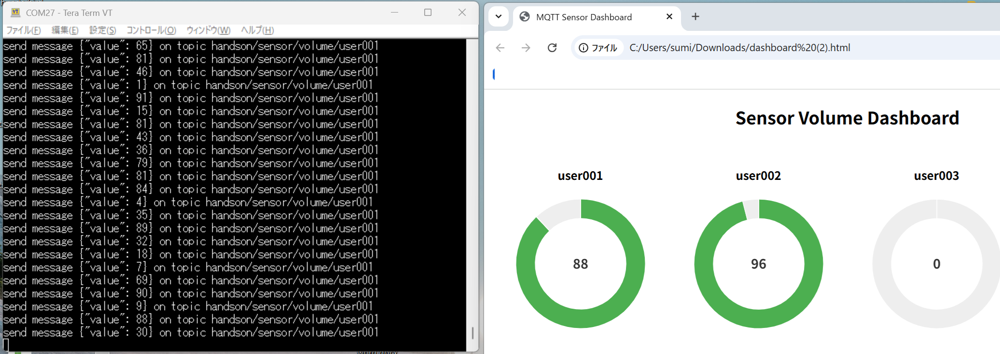

# MQTT　メッセージを発行(publish)

## MQTTライブラリを使ったPublish

まずは単純なサンプルとして、一定周期でメッセージを発行する例を示します。

- 接続先ブローカ：broker.emqx.io
- ポート番号：1883
- TOPICS： handson/sensor/volume/<user_ID>     #   <user_id>  := 受講者ID（001-016) (上位0埋め3桁数字)
- message: {"value" : ＜value＞ }               # ＜value＞ := 0 - 100　(上位0埋めなし、任意の桁数)

1秒おきにMQTTブローカにメッセージを送信する例です。メッセージのデータ形式はJSONです
```
#
# MQTT Publish Sample
#   publish random value
# 
import time
import random
import json
from umqtt.simple import MQTTClient

# define MQTT Broker
BROKER = "broker.emqx.io"
PORT = 1883
TOPIC_BASE = "handson/sensor/volume/user"
MEMBER_ID = 1
CLIENT_ID = f'rpi_pico_{MEMBER_ID:03d}'
TOPIC = TOPIC_BASE + f"{MEMBER_ID:03d}"

def connect():
    print(f'Connected to MQTT Broker {BROKER}')
    client = MQTTClient(CLIENT_ID, BROKER, PORT)
    client.connect()
    return client

def reconnect():
    print(f'Failed to connect to MQTT broker {BROKER}, Reconnecting...')
    time.sleep(5)
    client.reconnect()

# setup

try:
    client = connect()
except OSError as e:
    reconnect()

# loop

while True:
   value = random.randint(1, 100)  # random number 1-100
   msg = json.dumps({"value": value})
   print('send message %s on topic %s' % (msg, TOPIC))
   client.publish(TOPIC, msg, qos=0)
   time.sleep(1)

#
# end of source
#
```
本当に送信できているのか？を確認するためのIoTダッシュボードのサンプルは以下です。ダウンロードしてブラウザで開いてください。<br>
[dashboard.html](src/mqtt_dashboard/dashboard.html)<br>
上記HTMLファイルをブラウザで表示すると、JavaScriptが実行され、MQTT Clientとして動作します。トピックとして、handson/sensor/volume/user001  ～　handson/sensor/volume/user016をサブスクライブしています。<br>
このコードはCopilotに依頼して生成したままです。(JS苦手なので生成AIに丸投げで自分では何も加工していません)<br>改めて読み直すと、上位階層でサブスクライブした方が良いのではと思いました。

   
