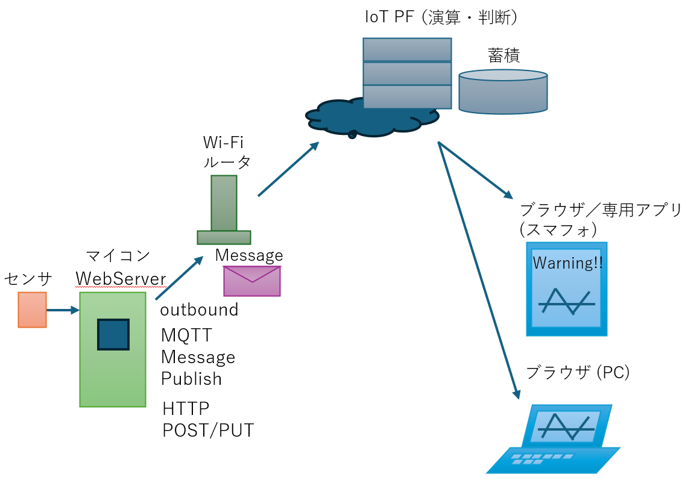

# 4-20 IoT PFへの接続、利用

マイコンをIoT プラットフォームと接続して、測定したデータをアップロードすることで、データの長期保存や、グラフ化、データの変化に基づく機器の制御や通知等が可能になります。

## 通信機能を持つマイコンシステムのデザインパターン：パターン３

|パターン名|構成図|特徴|
|--|--|--|
|パターン３：IoT プラットフォームによるデータ蓄積、演算、判断| (図の矢印はデータ(情報)が流れる方向を示しています)|・IoT プラットフォームを契約してデータ蓄積、一覧化、演算、判断が可能 ・IoT プラットフォームによりアカウント管理可能|

## IoT プラットフォームの利用方法

多機能なIoTプラットフォームですが、多くのサービスは有償であり、もしくは、アカウント登録した後、無料枠で使うことになります。個人で利用しやすいIoTプラットフォームを紹介します。また、オープンソースとして提供されているIoT プラットフォームもあります。自分でサーバを構築して個人運用のIoT プラットフォームを運用することもできます。サーバを立てる時はセキュリティに注意が必要です。

データを蓄積、分析する方法として、クラウド上のサーバを立てずとも、MQTT Clientとして自分のPCにメッセージを収集、蓄積、分析することも可能です。この方法はインターネット上にサーバを立てる必要がなく、セキュリティリスクも低く抑えられます。

### クラウドサービスとして提供されるIoTプラットフォーム

認証機能、データストレージ、ダッシュボード機能等が用意されたIoT プラットフォームサービスとして以下が挙げられます。
- Ambient(ambidata.io)
  - 無償利用可能、有償版もあり
  - シンプルな仕様で手軽に使える
  - ダッシュボード機能は最低限の機能
  - 提供されるSDKを用いてデータアップロード
- Adafruit IO
  - 無償利用可能、データ保存期間が短い、ダッシュボード機能あり 
- ArduinoCloud（https://cloud.arduino.cc/）
  - Arduinoユーザ囲い込み戦略、接続できるボードはArduinoと互換ボード
  - IDE統合型サービス 
- ThingSpeak
  - 無償利用可能
  - ストレージ機能は強力だが、ダッシュボード機能は最低限
  - MATLABと組み合わせて使うことを想定
  - HTTPS,POSTメソッドか、MQTT Publishによるデータ登録
- ThinsBoard(https://thingsboard.io/)
  - 有償サービス、マルチユーザ対応
  - GUI操作によるダッシュボード構築
  - ブロックプログラミングでデータ処理ルールを作成可能
  - CommunityEdition版(CE版)を使うことでセルフホスティングも可能
  - 無償利用可能
- Blynk (https://www.blynk.io/) 
  - 有償サービス、高機能、リッチな画面構築可能、スマフォからの閲覧、マルチテナント対応
  - 無償利用可能
- Thinger.io (https://thinger.io/)
  - 有償サービス、高機能、リッチな画面構築可能、スマフォアプリ
  - 無償利用可能（制限は。。）   
 
### オープンソース版IoTプラットフォームを構築する
- ThingsBoardのCommunity Editionを使う
  - PCかRPi上でThingsBoardを稼働させる
  - ThingBoardのダッシュボード機能が利用できる
  - 認証機能があるので、インターネット上での提供は可能だが、第三者から攻撃されるリスクも考慮すべき
  - AWSと契約、EC2またはECS上でThingsBoardのCommunity Editionを稼働させる方法もある
  - 構築手順は以下のドキュメントをご参照ください
    - [aaa](sup-3-1-dashboard-thigsboard.md) 

### ローカルＰＣ上にIoTダッシュボードを構築する
- [Node-RED Dashboard機能を使う](sup-4-2-dashboard-node-red.md)
  - PCかRPi上でNode-REDを稼働させ、Dashboard機能を使ってIoT ダッシュボードを構築する
  - Visual Programmingを基本に、最低限のJS Codeによりダッシュボードが構築可能
  - セキュリティ面から、サービス提供はローカルネットワーク環境のみに制限すべき(インターネット上でのサービス提供は危険)
  - 遠隔地からNode-RED dashboardを参照させたい場合はVPN等を構築
  - Node-REDをクラウド上で構築・運用できるサービスもある
- Streamlit, NiceGUI等を使ってIoTダッシュボードを自作
  - Python+NiceGUI(Streamlit)を使ってWebServiceを開発、PCかRPi上でWebServiceを稼働させる
  - NiceGUI/Streamlitの場合Widgetが用意されており、画面構築は比較的容易(VisualProgrammingよりは手間)
  - 自分で実装するので自由度が高い、表示対象データの特性に最適化可能
  - セキュリティ面から、インターネット上でのサービス提供は不可
  - ローカルネットワーク環境からの利用に留めるべき
  - IoTプロトタイプ試作の学びに適する
    - センサ→マイコン(RP2W)→MQTTブローカ→IoTダッシュボード自作(onPC/RPi)というIoTシステムの試作を通してシステム設計開発を学べる

上記自前構築の場合、RP2WとPC(またはRaspberryPi)との接続は、USB Serial(仮想COMポート)か、MQTTによる接続を選ぶことができます。MQTT Brokerを介してMQTTでRP2Wと接続することで、遠隔地のRP2Wの計測値を表示することが可能になります。クラウドサービスとして提供されるIoTプラットフォームを採用する場合、RP2WとIoTプラットフォームとの接続はHTTP/HTTPS/MQTTのいずれかになります。
