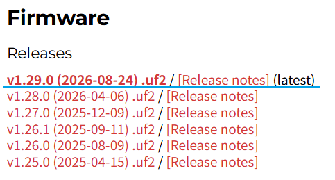

# Pico2Wのセットアップ
Rico2Wを購入後、FLASHに何か書き込まれている可能性がありますが、以下の手順でMicroPythonプログラム（ファームウエア）をPico2W上のFLASHメモリに焼きます

1. 最新版のMciroPythonファームウエアをMicroPython公式サイトからPCにダウンロードします
2. Pico2Wのボード上のBOOTSLボタンを押しながらUSBケーブルを使ってPCと接続します。BOOTSELボタンを押した状態で電源投入されると、Pico2Wはマスストレージモードで起動します。
3. PC側では新しいドライブとして認識されます。新しいドライブ(Dドライブか、Eドライブ)に最新版ファームをコピーします
4. Rico2Wのボード上のFLASHにファームが焼かれます。

#### MicroPython公式サイト 
Pico2W用ファームウエアダウンロードページ：https://micropython.org/download/RPI_PICO2_W/ 

# Pico2WのFLASHを何もない状態に戻す方法
boot.pyにバグがありREPLが起動できない場合があります。boot.pyを消すために、MicroPythonファームを再度焼いてもFLASH領域のユーザプログラムが温存され、boot.pyが消えずに残ります（よってREPLで起動できない状態が続きます）。
このような場合、FLASHにnuke_universal.uf2を焼くことで、FLASH領域の内容が初期状態に戻ります。焼く手順は上記MicroPythonファームを焼く手順と同じです。nuke_universl.uf2を焼いてFLASHを初期状態にした後、再度MicroPythonファームを焼くことでユーザプログラムが無い状態に更新できます。

#### nuke DLサイト(GitHub) 
GitHub：https://github.com/raspberrypi/pico-sdk-prebuilts/releases
