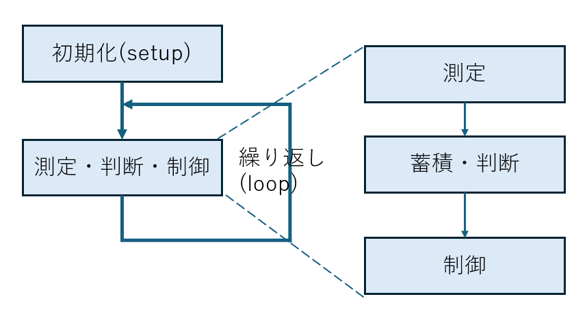

# 組み込みプログラミングの基本構造と作り方

## プログラムの基本構造
マイコンを使ったIoT用プログラムは、基本的に用途として、エッジ端末としての使い方が主になると思われます。センサで値を取得、蓄積、判断し、表示装置やモータ、警告灯を使ってフィードバックします。また、場合によってはIoT プラットフォームに測定データを送信します。
センサを活用した組み込みプログラミングの場合、ソースは以下の構造になります。

setup/loopと書いていますが、概念上の表現です。関数名としてsetup(),loop()にしないといけないと言った制約はありません。

### 初期化処理(setup)
- 使用するセンサや出力装置の初期化を行います
  - 接続手段に応じて、周辺IOを初期化
  - センサや出力装置のドライバを初期化
  - データを蓄積する配列等の作成

### 繰り返し処理(loop)
- 測定、蓄積判断、出力を繰り返します
  - 測定：センサを使って環境や監視対象の情報を取得
  - 判断：得られた値に対して判断を行います。過去に取得した値をベースに正常、異常の判断を行う場合があります。センサから得られる値はそのまま使える場合もありますが、異常値判断、フィルタによる平滑化等の各種処理が必要になる場合があります。
  - 出力：モータやディスプレイ、警告灯等を使って出力します。HTTPやMQTTを使って測定値をIoT PFにアップロードする場合もあります
 
#### ソースコードの例
[演習：対象物までの距離を計測してLCDに表示する](https://github.com/foobarbazfred/Pico-MicroPython-Workshop/blob/main/3-Day1-Foundation/3-7-distance-sensor.md#%E6%BC%94%E7%BF%92%E5%AF%BE%E8%B1%A1%E7%89%A9%E3%81%BE%E3%81%A7%E3%81%AE%E8%B7%9D%E9%9B%A2%E3%82%92%E8%A8%88%E6%B8%AC%E3%81%97%E3%81%A6lcd%E3%81%AB%E8%A1%A8%E7%A4%BA%E3%81%99%E3%82%8B)

## センサを活用したマイコン用プログラムの作り方（設計・実装・テスト）
1. 構造設計
   1. アプリの目的を明確化 
   2. 目的に応じて使うセンサを選択
   3. 出力手段を決定(液晶パネル、LED、音、音声、アクチュエータやサーボモータ、IoT PFへの送信)
   4. 周辺IOや入出力ピンが要件を満たすか確認(デバイスの電圧も確認)
   5. 測定データ判断方法を決定
2. プログラム設計
   1. センサの接続方法(UART/I2C/SPI等)を確認、センサ用のドライバを確認
   2. 出力手段の接続方法を確認
   3. ピン配置を決定(pinごとに用途が決まっています)
   4. 判断方法（アルゴリズム）を決定
3. 実装
   1. センサのドライバを入手、単体で動かして正常に値が取れることを確認
   2. 出力手段がデバイスの場合、ドライバを入手、単体で動かして出力されることを確認
   3. 出力手段がIoT PFへのデータ送信の場合、認証トークンを取得して、値がPOSTできることを確認
   4. 入出力デバイスを制御できるように初期化処理を実装(setupの部分)
   5. 蓄積・判断のアルゴリズムを実装。永続化が必要な場合、SD-CARD等の利用を検討する
   6. 入力・判断・出力のメインループを実装(loopの部分)
4. テスト
   1. アプリが正常に動作するかテストします。センサの最大値、最小値、中間値等で正しく動作するかテストします
   2. メモリサイズや速度が問題になる場合があります。扱うべきデータが大きすぎて配列が確保できない場合、SD-CARDを一時記憶領域として使う方法や、PSRAM搭載のボードに変更する対応が必要になる場合があります。速度が不足している場合、MicroPython言語のままでチューニングして速度改善する、あるいは、プログラミング言語自体の見直しを行います
   3. 長期運用の場合、プログラムのメモリ枯渇が起きないか、バッファフルにならないか、
   4. 異常時のテストして、再起動後、正常動作するかを確認
   5. ネットワーク経由の場合ネットワーク断による異常動作が発生しないかを確認します  
    
