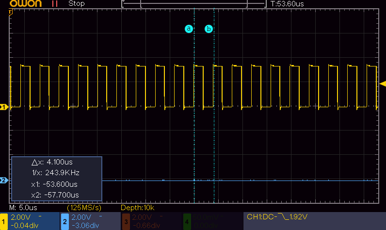

# MicroPythonの性能改善
MicroPythonで試作した際、データ取り込みや取り込んだデータの処理速度が若干不足する場合があります。MicroPythonの公式ドキュメントに高速化手法が紹介されています。

MicroPython 性能の最大化
ドキュメントURL:https://micropython-docs-ja.readthedocs.io/ja/latest/reference/speed_python.html

処理速度改善のためには、まず最初に、アルゴリズムやコードを改良して無駄な処理や演算量を減らす取り組みが重要です。ソースコード上もう削減できないという場合に、実装コードをレジスタ直接アクセス方式に書き替えたり、native/viper修飾子（デコレータ）による最適化を導入して処理速度を高速化することが可能です。
このような手法を用いることで、どの程度処理が早くなるのか処理時間を計測しました。
高速化した結果どれだけ効果が得られるかは、適用対象のプログラムの特性に依存します。例えば、メモリ上のデータを使った演算が多いプログラム、あるいは、周辺I/Oとのアクセスが多いプログラム等、どのようなコードが多いのか、プログラムによって性質が異なります。本研修ではセンサや各種出力装置を制御するコードが多いという観点で、GPIOの信号をL/Hするシンプルなプログラムを取り上げます。GPIO操作中心のソフトウエアが最適化によりどの程度高速になるのかを調べました。

### 測定条件
- システムクロックは150MHzに設定
- 評価に使用したMicroPythonファームバージョン：MicroPython v1.29.0 on 2026-08-24; Raspberry Pi Pico 2 W with RP2350

GPIOの出力をL/Hに連続的に切り替えるテストプログラムを実行して、オシロスコープを用いて周期を計測しました。
プログラム本体は以下のような単純なループです
```
while True:
    pin.high()
    pin.low()
```
以下はオシロスコープによる1周期測定例<br>
ループが１周実行されるごとに１パルスが生成される。パルス幅（周波数）がループの速度を表す。


### 計測結果整理

#### GPIO操作をレジスタ直接操作した場合の高速化効果（逆効果）
ソフトウエアでL/Hのパルスを生成させ、周波数を測定。周波数が高いほど、また、周期が短いほど、プログラムが高速に実行されていると判断できます。
|  *  | REPL	|ループ処理関数化| <- + PIN操作関数・レジスタ化 | <- + PIN操作インライン展開|
|---|----|----|----|----|
|パルスの周期|	73.53KHz / 13.600us	|192.3KHz / 5.200us	|65.79KHz/15.200us | 142.9KHz/7.00us|
|性能比率(*)	|0.38倍|	1倍|	0.34倍|	0.74倍|

*:測定されたパルスの周波数に基づき性能が何倍になったのか、倍数を計算

#### 考察
- 対話的実行(REPL)は関数定義による実行に比べ0.4倍の速度
- MicroPythonのPin操作関数の速度改善のつもりで、GPIOレジスタを直接操作しても速度は改善されない
   - GPIOレジスタに直接アクセスせずとも、提供されている関数を使って普通に実装するだけで十分な性能が得られる(クラス抽象化によるオーバーヘッドは極力抑えられている)

#### native / viper 最適化による高速化
ソフトウエアでL/Hのパルスを生成させ、周波数を測定。周波数が高いほど、プログラムが高速に実行されていると判断できます。
|*| ループ処理関数化|<- + PIN操作関数・レジスタ化 | <- + PIN操作インライン展開|
|--|--|--|--|
|修飾なし|192.3KHz(1倍)|65.79KHz(0.34倍)|142.9KHz(0.74倍)|
|native最適化|250.0KHz(1.3倍)|78.13KHz(0.41倍)|188.7KHz(0.98倍)|
|viper最適化|252.5KHz(1.3倍)|217.4KHz(1.1倍)|694.4KHz(3.6倍)|

補足：括弧内は測定された周波数に基づく性能比率。修飾しないループ処理関数化版ソースによる実行性能を１として、何倍処理時間が速くなったかを計算

#### 考察
- native最適化による高速化は1.3倍程度
- インライン展開した上でGPIOレジスタ操作に書き換えてviper最適化を適用すると、3.6倍まで高速化できる
- 関数化した場合と、インライン展開した場合の差は関数呼び出しによるオーバーヘッドと思われる

# 性能調査で用いたソース一式

### MicroPython REPL版
```
import machine
from machine import Pin

machine.freq(150_000_000)
print(machine.freq())   # 150_000_000
pin1 = Pin(1, Pin.OUT)

while True:
    pin1.high()
    pin1.low()

# 73.53KHz/13.600us
```
### MicroPython ループ処理関数化
```
import machine
from machine import Pin

def speed_test(pin):
    while True:
        pin.high()
        pin.low()
    
machine.freq(150_000_000)
print(machine.freq())   # 150_000_000
pin1 = Pin(1, Pin.OUT)

speed_test(pin1)
# 192.3KHz/5.200us
```
### MicroPython ループ処理関数化＋Pin操作関数・レジスタ化
```
import machine
from machine import Pin

#SIO_BASE_REG = 0xd0000000
#SIO_GPIO_OUT_SET_REG_OFFSET = 0x18
#SIO_GPIO_OUT_CLR_REG_OFFSET = 0x20

def _gp1_set():
    # 0xd0000018 : SIO_GPIO_OUT_SET_REG
    machine.mem32[0xd0000018] = 0x00_02  # 0x00_02 means gpio:1

def _gp1_clear():
    # 0xd0000018 : SIO_GPIO_OUT_CLR_REG
    machine.mem32[0xd0000020] = 0x00_02  # 0x00_02 means gpio:1

def _gp1_set_clr():
    while True:
        _gp1_set()
        _gp1_clear()

machine.freq(150_000_000)
print(machine.freq())   # 150_000_000
pin1 = Pin(1, Pin.OUT)
_gp1_set_clr()
# 65.79KHz/15.200us
```

### MicroPython ループ処理関数化＋Pin操作インライン展開
```
import machine
from machine import Pin

#SIO_BASE_REG = 0xd0000000
#SIO_GPIO_OUT_SET_REG_OFFSET = 0x18
#SIO_GPIO_OUT_CLR_REG_OFFSET = 0x20

def _gp1_set_clr():
    while True:
        # 0xd0000018 : SIO_GPIO_OUT_SET_REG
        machine.mem32[0xd0000018] = 0x00_02  # 0x00_02 means gpio:1
        # 0xd0000018 : SIO_GPIO_OUT_CLR_REG
        machine.mem32[0xd0000020] = 0x00_02  # 0x00_02 means gpio:1

machine.freq(150_000_000)
print(machine.freq())   # 150_000_000
pin1 = Pin(1, Pin.OUT)
_gp1_set_clr()
# 142.9KHz/7.00us
```

### MicroPython言語 ループ処理関数化＋native最適化 ソース
```
import machine
from machine import Pin

@micropython.native
def speed_test(pin):
    while True:
        pin.high()
        pin.low()
    
machine.freq(150_000_000)
print(machine.freq())   # 150_000_000
pin1 = Pin(1, Pin.OUT)

speed_test(pin1)

# 250.0KHz/4.000us
```

### MicroPython言語 ループ処理関数化＋viper最適化 ソース
```
import machine
from machine import Pin

@micropython.viper
def speed_test(pin):
    while True:
        pin.high()
        pin.low()
    
machine.freq(150_000_000)
print(machine.freq())   # 150_000_000
pin1 = Pin(1, Pin.OUT)

speed_test(pin1)

# 252.5KHz/3.960us
```


### MicroPython言語 ループ処理関数化＋Pin操作関数+native最適化
```
import machine
from machine import Pin

#SIO_BASE_REG = 0xd0000000
#SIO_GPIO_OUT_SET_REG_OFFSET = 0x18
#SIO_GPIO_OUT_CLR_REG_OFFSET = 0x20

@micropython.native
def _gp1_set():
    # 0xd0000018 : SIO_GPIO_OUT_SET_REG
    machine.mem32[0xd0000018] = 0x00_02  # 0x00_02 means gpio:1

@micropython.native
def _gp1_clear():
    # 0xd0000018 : SIO_GPIO_OUT_CLR_REG
    machine.mem32[0xd0000020] = 0x00_02  # 0x00_02 means gpio:1

@micropython.native
def _gp1_set_clr():
    while True:
        _gp1_set()
        _gp1_clear()

machine.freq(150_000_000)
print(machine.freq())   # 150_000_000
pin1 = Pin(1, Pin.OUT)
_gp1_set_clr()

# 78.13KHz/12.800us
```
### MicroPython言語 ループ処理関数化＋Pin操作関数+viper最適化
```
import machine
from machine import Pin

#SIO_BASE_REG = 0xd0000000
#SIO_GPIO_OUT_SET_REG_OFFSET = 0x18
#SIO_GPIO_OUT_CLR_REG_OFFSET = 0x20

@micropython.viper
def _gp1_set():
    # 0xd0000018 : SIO_GPIO_OUT_SET_REG
    ptr32(0xd0000018)[0] = 0x00_02  # 0x00_02 means gpio:1

@micropython.viper
def _gp1_clear():
    # 0xd0000018 : SIO_GPIO_OUT_CLR_REG
    ptr32(0xd0000020)[0] = 0x00_02  # 0x00_02 means gpio:1

@micropython.viper
def _gp1_set_clr():
    while True:
        _gp1_set()
        _gp1_clear()

machine.freq(150_000_000)
print(machine.freq())   # 150_000_000
pin1 = Pin(1, Pin.OUT)
_gp1_set_clr()

# 217.4KHz/4.600us
```

### MicroPython言語 ループ処理関数化＋Pin操作インライン展開+native最適化 
```
import machine
from machine import Pin

@micropython.native
def _gp1_set_clr():
    while True:
        # 0xd0000018 : SIO_GPIO_OUT_SET_REG
        machine.mem32[0xd0000018] = 0x00_02  # 0x00_02 means gpio:1
        # 0xd0000018 : SIO_GPIO_OUT_CLR_REG
        machine.mem32[0xd0000020] = 0x00_02  # 0x00_02 means gpio:1
    
machine.freq(150_000_000)
print(machine.freq())   # 150_000_000
pin1 = Pin(1, Pin.OUT)
_gp1_set_clr()

# 188.7KHz/5.300us
```

### MicroPython言語 ループ処理関数化＋Pin操作インライン展開+viper最適化
```
import machine
from machine import Pin

#SIO_BASE_REG = 0xd0000000
#SIO_GPIO_OUT_SET_REG_OFFSET = 0x18
#SIO_GPIO_OUT_CLR_REG_OFFSET = 0x20

@micropython.viper
def _gp1_set_clr():
    while True:
        # 0xd0000018 : SIO_GPIO_OUT_SET_REG
        ptr32(0xd0000018)[0] = 0x00_02  # 0x00_02 means gpio:1
        # 0xd0000020 : SIO_GPIO_OUT_CLR_REG
        ptr32(0xd0000020)[0] = 0x00_02  # 0x00_02 means gpio:1

machine.freq(150_000_000)
print(machine.freq())   # 150_000_000
pin1 = Pin(1, Pin.OUT)
_gp1_set_clr()

# 694.4KHz (1.440us)
```
