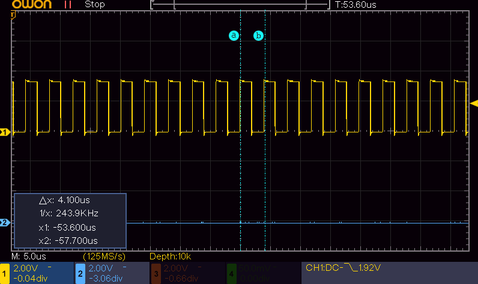

# MicroPythonの性能改善
MicroPythonで実装した際、速度が足りない場合があります。高速化手法がありどの程度早くなるのか単純なGPIOのL/Hを繰り返すプログラムで処理時間を計測しました。<br>
テストプログラムを実行して、オシロスコープを用いて周期を計測しました。以下は例です<br>


### 考察

|  *  | REPL	|ループ処理関数化| <- + PIN操作関数・レジスタ化 | <- + PIN操作インライン展開|
|---|----|----|----|----|
|パルスの周期|	73.53KHz / 13.600us	|192.3KHz / 5.200us	|65.79KHz/15.200us | 142.9KHz/7.00us|
|処理時間比	|1|	1倍|	0.34倍|	119倍|
|考察	|REPL実行は低速|	関数実行を基準とする|レジスタ直接操作してもメソッド呼び出しに勝てない|<-同|

- システムクロックは150MHzに設定
- 評価に使用したMicroPythonファームバージョン：MicroPython v1.29.0 on 2026-08-24; Raspberry Pi Pico 2 W with RP2350


### MicroPython REPL版
```
import machine
from machine import Pin

machine.freq(150_000_000)
print(machine.freq())   # 150_000_000
pin1 = Pin(1, Pin.OUT)

while True:
    pin1.high()
    pin1.low()

# 73.53KHz/13.600us
```
### MicroPython ループ処理関数化
```
import machine
from machine import Pin

def speed_test(pin):
    while True:
        pin.high()
        pin.low()
    
machine.freq(150_000_000)
print(machine.freq())   # 150_000_000
pin1 = Pin(1, Pin.OUT)

speed_test(pin1)
# 192.3KHz/5.200us
```
### MicroPython ループ処理関数化＋Pin操作関数・レジスタ化
```
import machine
from machine import Pin

#SIO_BASE_REG = 0xd0000000
#SIO_GPIO_OUT_SET_REG_OFFSET = 0x18
#SIO_GPIO_OUT_CLR_REG_OFFSET = 0x20

def _gp1_set():
    # 0xd0000018 : SIO_GPIO_OUT_SET_REG
    machine.mem32[0xd0000018] = 0x00_02  # 0x00_02 means gpio:1

def _gp1_clear():
    # 0xd0000018 : SIO_GPIO_OUT_CLR_REG
    machine.mem32[0xd0000020] = 0x00_02  # 0x00_02 means gpio:1

def _gp1_set_clr():
    while True:
        _gp1_set()
        _gp1_clear()

machine.freq(150_000_000)
print(machine.freq())   # 150_000_000
pin1 = Pin(1, Pin.OUT)
_gp1_set_clr()
# 65.79KHz/15.200us
```

### MicroPython ループ処理関数化＋Pin操作インライン展開
```
import machine
from machine import Pin

#SIO_BASE_REG = 0xd0000000
#SIO_GPIO_OUT_SET_REG_OFFSET = 0x18
#SIO_GPIO_OUT_CLR_REG_OFFSET = 0x20

def _gp1_set_clr():
    while True:
        # 0xd0000018 : SIO_GPIO_OUT_SET_REG
        machine.mem32[0xd0000018] = 0x00_02  # 0x00_02 means gpio:1
        # 0xd0000018 : SIO_GPIO_OUT_CLR_REG
        machine.mem32[0xd0000020] = 0x00_02  # 0x00_02 means gpio:1

machine.freq(150_000_000)
print(machine.freq())   # 150_000_000
pin1 = Pin(1, Pin.OUT)
_gp1_set_clr()
# 142.9KHz/7.00us
```

### MicroPython言語 ループ処理関数化＋native最適化 ソース
```
import machine
from machine import Pin

@micropython.native
def speed_test(pin):
    while True:
        pin.high()
        pin.low()
    
machine.freq(150_000_000)
print(machine.freq())   # 150_000_000
pin1 = Pin(1, Pin.OUT)

speed_test(pin1)

# 250.0KHz/4.000us
```

### MicroPython言語 ループ処理関数化＋viper最適化 ソース
```
import machine
from machine import Pin

@micropython.viper
def speed_test(pin):
    while True:
        pin.high()
        pin.low()
    
machine.freq(150_000_000)
print(machine.freq())   # 150_000_000
pin1 = Pin(1, Pin.OUT)

speed_test(pin1)

# 252.5KHz/3.960us
```


### MicroPython言語 ループ処理関数化＋Pin操作関数+native最適化
```
import machine
from machine import Pin

#SIO_BASE_REG = 0xd0000000
#SIO_GPIO_OUT_SET_REG_OFFSET = 0x18
#SIO_GPIO_OUT_CLR_REG_OFFSET = 0x20

@micropython.native
def _gp1_set():
    # 0xd0000018 : SIO_GPIO_OUT_SET_REG
    machine.mem32[0xd0000018] = 0x00_02  # 0x00_02 means gpio:1

@micropython.native
def _gp1_clear():
    # 0xd0000018 : SIO_GPIO_OUT_CLR_REG
    machine.mem32[0xd0000020] = 0x00_02  # 0x00_02 means gpio:1

@micropython.native
def _gp1_set_clr():
    while True:
        _gp1_set()
        _gp1_clear()

machine.freq(150_000_000)
print(machine.freq())   # 150_000_000
pin1 = Pin(1, Pin.OUT)
_gp1_set_clr()

# 50.51KHz/19.800us
```
### MicroPython言語 ループ処理関数化＋Pin操作関数+viper最適化
```
import machine
from machine import Pin

#SIO_BASE_REG = 0xd0000000
#SIO_GPIO_OUT_SET_REG_OFFSET = 0x18
#SIO_GPIO_OUT_CLR_REG_OFFSET = 0x20

@micropython.viper
def _gp1_set():
    # 0xd0000018 : SIO_GPIO_OUT_SET_REG
    ptr32(0xd0000018)[0] = 0x00_02  # 0x00_02 means gpio:1

@micropython.viper
def _gp1_clear():
    # 0xd0000018 : SIO_GPIO_OUT_CLR_REG
    ptr32(0xd0000020)[0] = 0x00_02  # 0x00_02 means gpio:1

@micropython.viper
def _gp1_set_clr():
    while True:
        _gp1_set()
        _gp1_clear()

machine.freq(150_000_000)
print(machine.freq())   # 150_000_000
pin1 = Pin(1, Pin.OUT)
_gp1_set_clr()

# 217.4KHz/4.600us
```

### MicroPython言語 ループ処理関数化＋Pin操作インライン展開+native最適化 
```
import machine
from machine import Pin

@micropython.native
def _gp1_set_clr():
    while True:
        # 0xd0000018 : SIO_GPIO_OUT_SET_REG
        machine.mem32[0xd0000018] = 0x00_02  # 0x00_02 means gpio:1
        # 0xd0000018 : SIO_GPIO_OUT_CLR_REG
        machine.mem32[0xd0000020] = 0x00_02  # 0x00_02 means gpio:1
    
machine.freq(150_000_000)
print(machine.freq())   # 150_000_000
pin1 = Pin(1, Pin.OUT)
_gp1_set_clr()

# 188.7KHz/5.300us
```

### MicroPython言語 ループ処理関数化＋Pin操作インライン展開+viper最適化
```
import machine
from machine import Pin

#SIO_BASE_REG = 0xd0000000
#SIO_GPIO_OUT_SET_REG_OFFSET = 0x18
#SIO_GPIO_OUT_CLR_REG_OFFSET = 0x20

@micropython.viper
def _gp1_set_clr():
    while True:
        # 0xd0000018 : SIO_GPIO_OUT_SET_REG
        ptr32(0xd0000018)[0] = 0x00_02  # 0x00_02 means gpio:1
        # 0xd0000020 : SIO_GPIO_OUT_CLR_REG
        ptr32(0xd0000020)[0] = 0x00_02  # 0x00_02 means gpio:1

machine.freq(150_000_000)
print(machine.freq())   # 150_000_000
pin1 = Pin(1, Pin.OUT)
_gp1_set_clr()

# 694.4KHz (1.440us)
```
