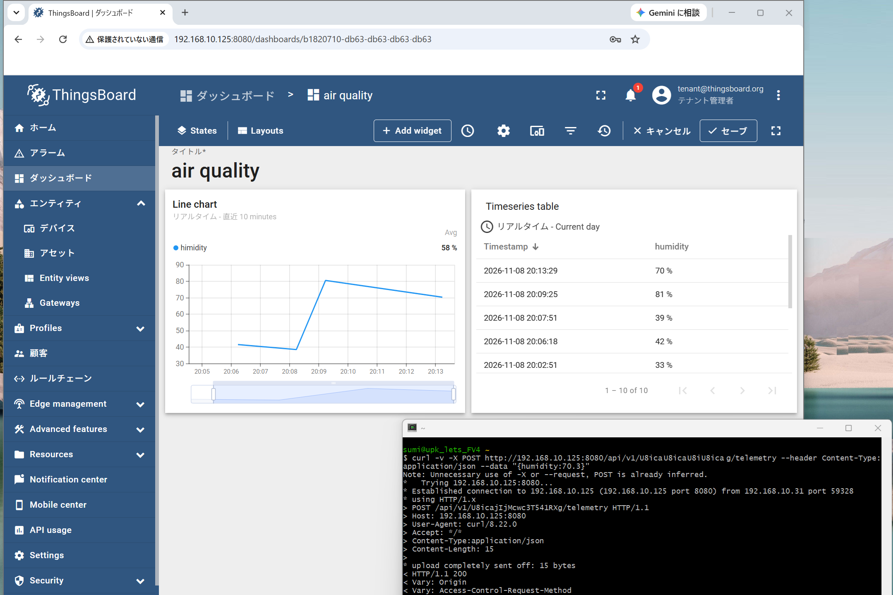

# ThingsBoardによるIoT プラットフォーム実装
ThingsBoardはクラウド版を使う場合、基本有償ですが、CommunityEdition版(CE版)が提供されており、サーバを調達して、自分でThingsBoardサービスを立ち上げることができます

- [GitHub](https://github.com/thingsboard/thingsboard)
- [ThingsBoard CE版Installガイド](https://thingsboard.io/docs/user-guide/install/installation-options/)


## Dockerを使ったThingsBoard構築例

Docker composeによるThingsBoardサービスの立ち上げ例を示します。
1. データ永続化のため、コンテナから外部ストレージとして使うディレクトリを作成します
```
mkdir -p ~/.mytb-data && sudo chown -R 799:799 ~/.mytb-data
mkdir -p ~/.mytb-logs && sudo chown -R 799:799 ~/.mytb-logs
```
UID:GIDを799:799にしているのは、Dockerコンテナ内でThingsBoardのプロセスが799:799で動作しており、ファイルR/W時に権限違反を起こさないため

2. Docker compose用のymlファイルを作成します。<br>
file:docker-compose.yml (ミニマム版)
```
services:
  mytb:
    restart: always
    image: "thingsboard/tb-postgres"
    ports:
      - "8080:9090"
      - "1883:1883"
      - "7070:7070"
      - "5683-5688:5683-5688/udp"
    environment:
      TB_QUEUE_TYPE: in-memory
    volumes:
      - ~/.mytb-data:/data
      - ~/.mytb-logs:/var/log/thingsboard
```
3. イメージをビルドしてコンテナを起動します
```
docker compose up -d
```
4. コンテナが起動されますので、ブラウザからThingsBoardのログイン画面にアクセスします


```
http://<サーバのIP>:8080/
```
サービス起動後のログインIDは以下を参照してください
[start the platform](https://thingsboard.io/docs/installation/docker/#step-3-start-the-platform)

### デバイスの登録
ThingsBoardに接続したいデバイス(RP2350 / RaspberryPi Pico 2W等)をThingsBoardに登録します。デバイスを登録することにより、アクセスURLが振り出されます。<br>
以下は接続テスト用URLです。POST用ＵＲＬの中で、v1に続く文字列がデバイス専用に振り出されたトークンです。
```
curl -v -X POST http://192.168.10.125:8080/api/v1/U8xxxxxxxRXg/telemetry --header Content-Type:application/json --data "{temperature:25}"
```
MQTT接続テスト用のパラメータは以下です
```
mosquitto_pub -d -q 1 -h 192.168.10.125 -p 1883 -t v1/devices/me/telemetry -u "U8xxxxxxxxxXg" -m "{temperature:25}"
```

### Dashboardの作成
収集されたデータを一覧表示したり、グラフ化できるよう、ダッシュボードを作成します。以下は作成が終わって収集データが表示される例です。<br>
<br>
接続テスト用URLを使ってデータをPOSTしています。


## MicroPythonによるMQTT Publish
curlコマンドやmosquittoコマンドによるデータ送信テストを確認したらMicroPythonでデータが送信できるかを試します。センサと接続する前に、ダミーデータで送信テストを行うのが良いと思います。以下はMicroPythonによりThingsBoardに対してメッセージをPublishするサンプルコードです。
```
from umqtt.simple import MQTTClient
import json

MQTT_SERVER = "192.168.10.125"
MQTT_PORT = 1883
CLIENT_ID = "pico_client_001"
ACCESS_TOKEN = "U8xxxxxxxxxXg"  # ThingsBoardから振り出されたアクセストークンを設定
TOPIC = "v1/devices/me/telemetry"

# 送信データ(json.dumps()関数を使って、辞書型データをJSON形式に変換)
payload = json.dumps({"temperature": 25})

def send_telemetry():
    client = MQTTClient(
        client_id=CLIENT_ID,
        server=MQTT_SERVER,
        port=MQTT_PORT,
        user=ACCESS_TOKEN,
        password="",
    )

    try:
        print("Connecting to ThingsBoard...")
        client.connect()
        
        print(f"Publishing to {TOPIC}: {payload}")
        client.publish(TOPIC, payload, qos=1)
        
    except Exception as e:
        print(f"Failed to publish: {e}")
        
    finally:
        try:
            client.disconnect()
            print("Disconnected.")
        except:
            pass

send_telemetry()
```

