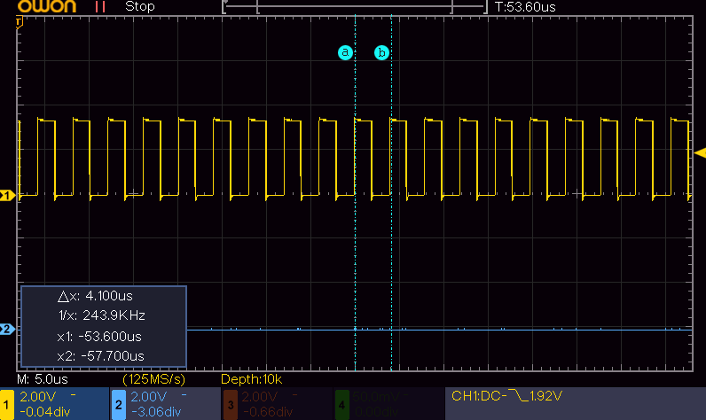

# MicroPythonの抽象化レベルによる性能差、C言語との性能差
MicroPythonとC言語との間でどれぐらい性能の差があるのかを単純なGPIOのL/Hを繰り返すプログラムで比較しました。<br>
テストプログラムを実行して、オシロスコープを用いて周期を計測しました。以下は例です<br>


### 考察
単純に、コンパイル型言語のC言語とインタプリタ型言語のMicroPython を比べるのはどうかとは思いつつ、性能差を把握するため比較

| |	C言語	| MP言語:REPL	|MP言語:関数化	| MP言語:関数化+native最適化	| MP言語:関数化+viper最適化+レジスタ直接書き込み|
|---|----|----|----|----|----|
|パルスの周期|	34.4ns (29MHz)	|21.6us(46KHz)	|5us (200KHz)	|4.1us(244KHz)|	1.44us(694KHz)|
|処理時間比	|1|	628倍|	145倍|	119倍|	42倍|

- クロックは150MHzに設定
- 関数化+viperはGPIOレジスタに直接書き込むコードを使っています

### C言語ソース
```
#include "pico/stdlib.h"
#include "hardware/clocks.h"  
#define OUT_PIN  1   // GPIO:1  for output

int main() {

    // set systemclock to 150MHz
    set_sys_clock_khz(150000, true);

    // setup GPIO for output
    gpio_init(OUT_PIN);
    gpio_set_dir(OUT_PIN, GPIO_OUT);

    while (true) {
       gpio_put(OUT_PIN, 1);   // H
       gpio_put(OUT_PIN, 0);   // L
    }
}
```

### MicroPython言語 REPL版ソース(Pin操作メソッド呼び出し)
```
import machine
from machine import Pin

print(machine.freq())
pin1 = Pin(1, Pin.OUT)

while True:
    pin1.high()
    pin1.low()
```
### MicroPython言語 関数化 ソース(Pin操作メソッド呼び出し)
```
import machine
from machine import Pin

def speed_test(pin):
    while True:
        pin.high()
        pin.low()
    
print(machine.freq())
pin1 = Pin(1, Pin.OUT)

speed_test(pin1)
```
### MicroPython言語 関数化 ソース(Pin操作関数呼び出し)
```
import machine
from machine import Pin

#SIO_BASE_REG = 0xd0000000
#SIO_GPIO_OUT_SET_REG_OFFSET = 0x18
#SIO_GPIO_OUT_CLR_REG_OFFSET = 0x20

_gp1_set():
    # 0xd0000018 : SIO_GPIO_OUT_SET_REG
    ptr32(0xd0000018)[0] = 0x00_02  # 0x00_02 means gpio:1

_gp1_clear():
    # 0xd0000018 : SIO_GPIO_OUT_CLR_REG
    ptr32(0xd0000018)[0] = 0x00_02  # 0x00_02 means gpio:1

def _gp1_set_clr():
    while True:
        _gp1_set()
        _gp1_clear()

print(machine.freq())
pin1 = Pin(1, Pin.OUT)
_gp1_set_clr()
```

### MicroPython言語 関数化＋native最適化 ソース
```
import machine
from machine import Pin

@micropython.native
def speed_test(pin):
    while True:
        pin.high()
        pin.low()
    
print(machine.freq())
pin1 = Pin(1, Pin.OUT)

speed_test(pin1)
```


### MicroPython言語 関数化+viper最適化+レジスタ直接書き込み ソース
```
import machine
from machine import Pin

#SIO_BASE_REG = 0xd0000000
#SIO_GPIO_OUT_SET_REG_OFFSET = 0x18
#SIO_GPIO_OUT_CLR_REG_OFFSET = 0x20

@micropython.viper
def _gp1_set_clr():
    while True:
        # 0xd0000018 : SIO_GPIO_OUT_SET_REG
        ptr32(0xd0000018)[0] = 0x00_02  # 0x00_02 means gpio:1
        # 0xd0000020 : SIO_GPIO_OUT_CLR_REG
        ptr32(0xd0000020)[0] = 0x00_02  # 0x00_02 means gpio:1

print(machine.freq())
pin1 = Pin(1, Pin.OUT)
_gp1_set_clr()
```
